# 一、MQ概述：

## 1.1 为什么需要MQ（Message Queue）？

Message Queue（消息队列）是系统间**异步传递消息**的基础设施。生产者把业务事件写入消息队列，消费者按自己的节奏拉取或接收消息，处理自己的业务逻辑。使用队列保存、传递消息，让不同服务不必直接同步调用彼此。

比如微服务项目中，多个服务是分开部署的，比如服务A要向服务B发送消息，如果服务B宕机了，那么这条消息就会直接丢失。

以“用户付款后发短信、加积分、通知仓库”为例：

**不用 MQ：**

```text
订单服务 ──同步调用──> 短信服务
       ├─同步调用──> 积分服务
       └─同步调用──> 仓库服务
```

下游任何一个服务响应慢，都可能拉长请求耗时；下游不可用还可能影响订单链路。

**而使用MQ：**

订单服务直接把事件消息放到MQ中，然后下游服务再自己从MQ中取出对应的消息

这样订单服务不再同步等待所有下游完成。

> **发布到 MQ 成功，并不意味着所有下游业务执行成功**。

## 1.2 优点和缺点

优点：

1. **异步**：主流程只处理必须同步完成的工作，其他工作由消费者异步完成。
2. **解耦**：生产者不必直接依赖每个消费者的部署地址、接口与可用性。
3. **削峰填谷**：上游短时间大量写入，队列先缓冲，再按下游处理能力消费。

> 例如：10,000 个请求，如果库存服务只能处理 1,000 个任务/秒，消息队列可缓冲请求，消费者按能力处理。

缺点：

1. 系统可用性降低

   系统引入的外部依赖越多，系统稳定性越差。一旦 MQ 宕机，就会对业务造成影响。

   > 如何保证MQ的高可用？

2. ### 系统复杂度提高

   MQ 的加入大大增加了系统的复杂度，以前系统间是同步的远程调用，现在是通过 MQ 进行异步调用。

   > 如何保证消息没有被重复消费？怎么处理消息丢失情况？那么保证消息传递的顺序性？

3. ### 一致性问题

   A 系统处理完业务，通过 MQ 给 B、C、D 三个系统发消息数据，如果 B 系统、C 系统处理成功，D 系统处理失败。

   > 如何保证消息数据处理的一致性？

## 1.3 基础概念：

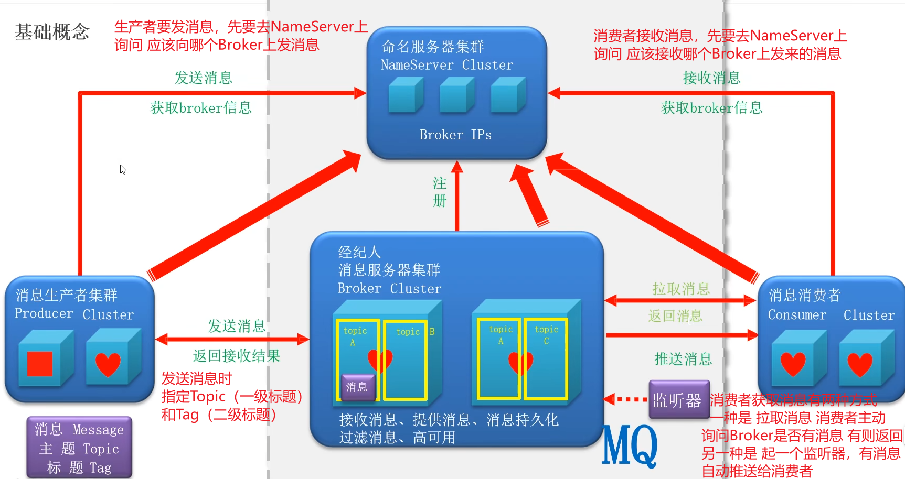

> 上面消费者 使用监听器获取消息时
>
> 建立的是长连接 也就是说会持续监听队列中的消息

- **NameServer**：轻量级路由发现服务，维护 Broker、Topic、Queue 的路由关系；Producer / Consumer 根据路由连接 Broker。
- **Broker**：负责消息写入、存储、读取、消费进度与重试等。
- **Producer**：查询 Topic 路由后直接向对应 Broker 发送消息。
- **Consumer**：订阅 Topic，拉取 / 消费 Broker 上的消息。

### 简单认识一下里面的名词：

> 有的之后会详细讲

| 名词           | 含义                           |                                        |
| -------------- | ------------------------------ | -------------------------------------- |
| Topic          | 消息主题，逻辑分类             | 例如 `fruit`                           |
| Tag            | Topic 下更细的业务标签         | 例如 `fruit`可以分为`apple` 和`banana` |
| MessageQueue   | Topic 内可独立写入和消费的队列 | 一个 Topic 通常有多个                  |
| Producer Group | 生产者分组                     | 4.x 事务消息等场景有意义               |
| Consumer Group | 消费者分组                     | 定义一组协作消费同一订阅的实例         |
| NameServer     | 路由服务                       | 告知其他服务 Broker 在哪里             |
| Broker         | 消息存储与服务节点             | 真正接收、保存消息                     |
| Offset         | 队列中的逻辑位置               | 用来标识读取 / 消费进度                |
| ACK            | 确认信号 / 消费结果确认概念    | 发送确认、消费结果不可混淆             |
| Listener       | 监听器回调                     | 收到消息时执行 Java 代码               |

#  二、安装RocketMQ：

直接下载RocketMQ 4.8链接

https://archive.apache.org/dist/rocketmq/4.8.0/rocketmq-all-4.8.0-bin-release.zip

其他版本下载地址：

https://rocketmq.apache.org/download

## 1.windows配置和启动步骤：

1.解压下载好的压缩包

2.复制解压后的文件路径

3.在环境变量中添加一个系统变量

```cmd
ROCKETMQ_HOME
值：是刚才解压后的文件路径 以我的为例就是如下图所示
```

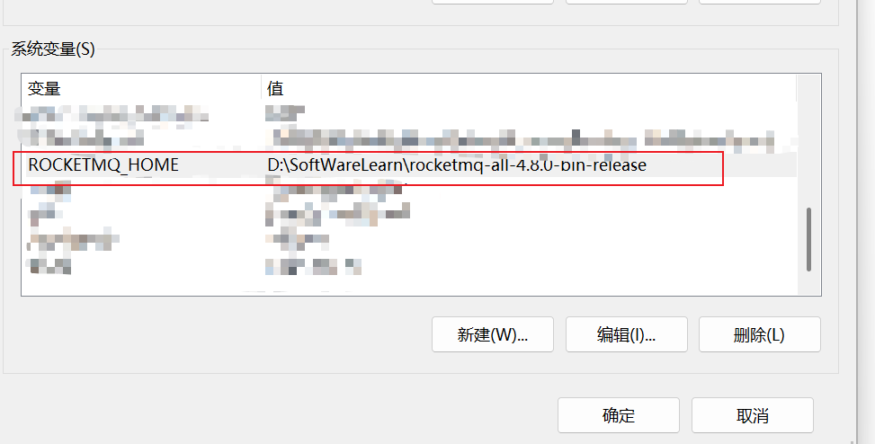

启动：

1.启动NameServer：

在解压出来的目录中打开bin目录

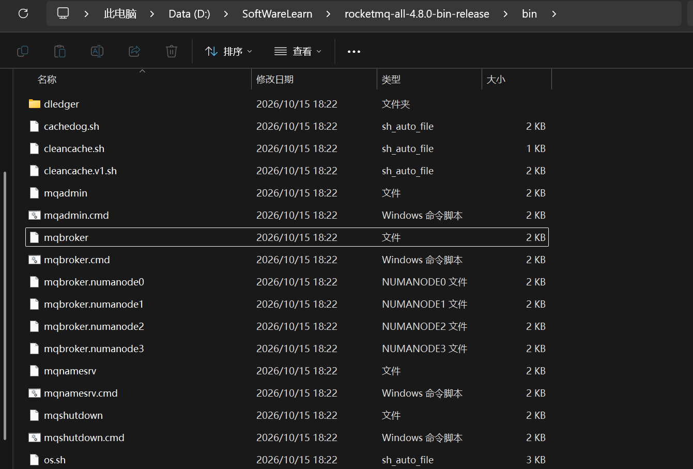

在上方输入cmd （这样打开cmd后 直接进入的就是这个目录）

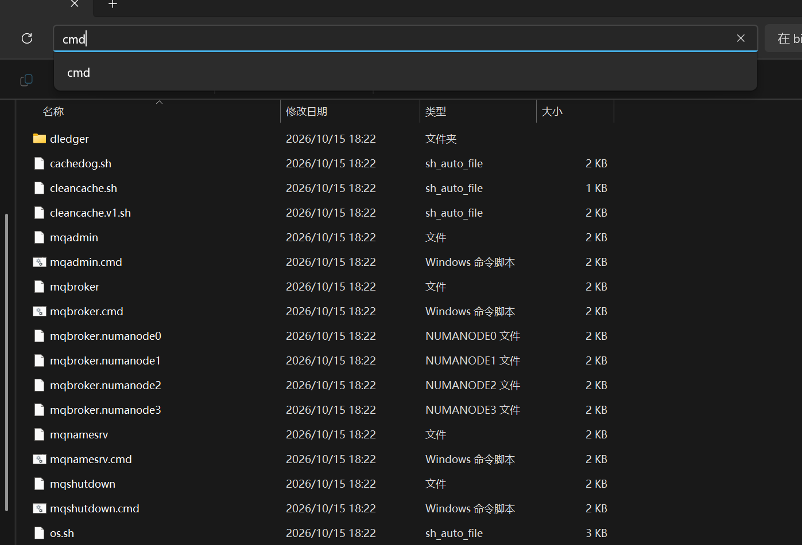

输入

```cmd
start mqnamesrv.cmd
```

会弹出一个新的cmd窗口  显示下面 说明启动成功：

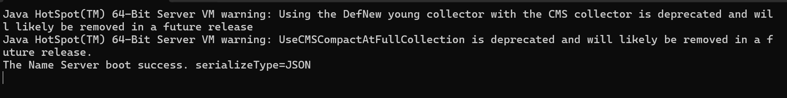

> 成功之后不要关闭窗口了

2.启动Broker：

在最初打开的cmd窗口中

输入如下命令：

```cmd
start mqbroker.cmd -n 127.0.0.1:9876 autoCreateTopicEnable=true
```

> -n 用来指定对应的NameServer 的地址和端口
>
> autoCreateTopicEnable=true 设置Broker自动创建Topic

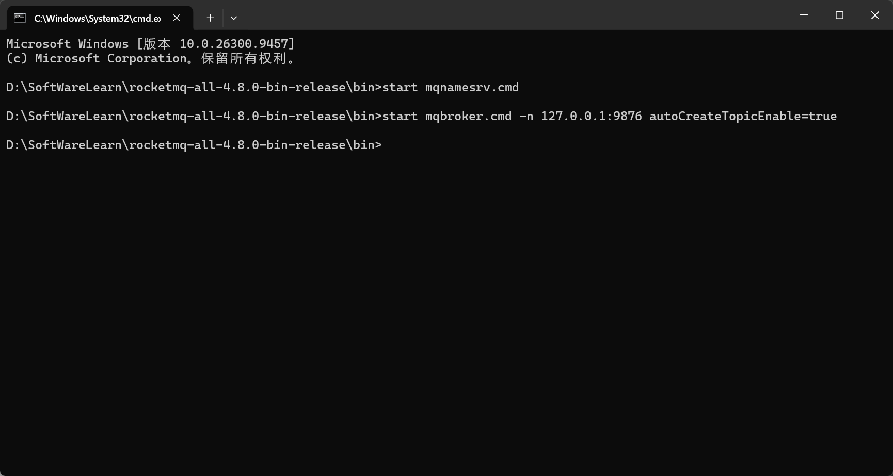

然后会弹出一个新的cmd窗口：

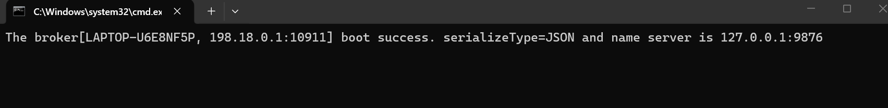

> 显示这个说明启动成功了，同时也不要关闭这个窗口

## 2.测试是否配置是否正确：

有RocketMQ自带的 测试工具

### 1.新增一个环境变量：

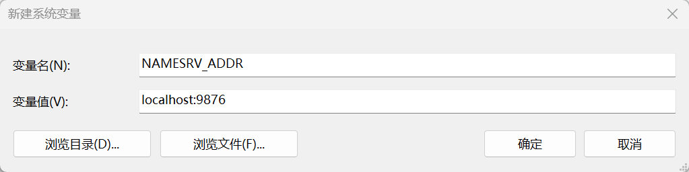

```cmd
变量名：NAMESRV_ADDR
变量值：localhost:9876
```

> 新增完环境变量之后 要重启一下最开始打开的cmd窗口

### 2.测试生产者发送消息：

重启之后 输入以下指令

```python
tools.cmd org.apache.rocketmq.example.quickstart.Producer
```

> 这个测试生产者会发送1000条消息（默认值）
>
> 怎么计算的？ 这里有四个队列 每个队列初始的偏移量都是250 最后都变成了499
>
> 所以每个队列的消息数是 499-250+1=250 总消息数：250*4=1000
>
> 当然因为这是我执行的第二次，所以偏移量不是从0开始，这也说明了偏移量并不代表这个队列发送了多少条消息 而是最终偏移量-初始偏移量+1 才是这次队列发送了多少消息
>
> 而这个偏移量只能说明 这个队列从创建到现在一共发送了多少消息

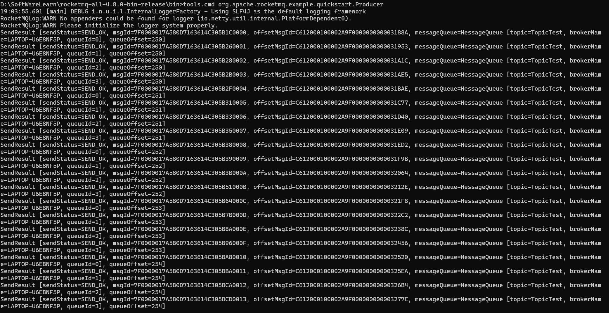

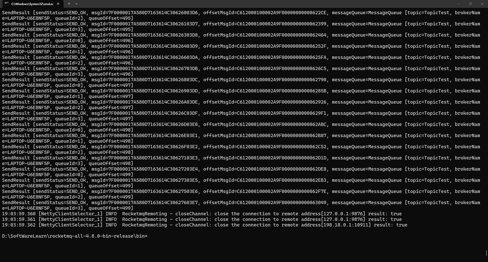

`SendResult` 是 RocketMQ 生产者调用 `producer.send(msg)` 后返回的发送结果对象。

以一条内容为例：

```java
SendResult [
    sendStatus=SEND_OK,
    msgId=7F0000017A580D7163614C30626003D6,
    offsetMsgId=C612000100002A9F00000000000622CE,
    messageQueue=MessageQueue [
        topic=TopicTest,
        brokerName=LAPTOP-U6E8NF5P,
        queueId=2
    ],  //从这里可以得出  Topic + BrokerName + QueueId 才能唯一定位一个逻辑消息队列。
    //队列是按 Topic 组织的，但实际存储在 Broker 上。
    queueOffset=495
]
```

#### 解释Topic、Broker、Queue 的关系：

#### 单个Broker情况：

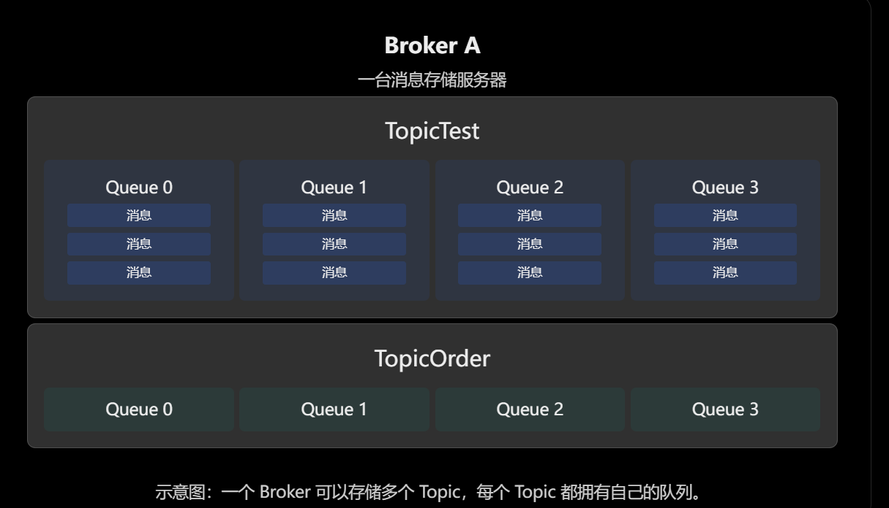

#### 多个Broker:

假设 RocketMQ 集群里存在两个 Broker，并且 `TopicTest` 在每个 Broker 上都配置了 4 个写队列。

那么此时`TopicTest` 总队列数 =4+4=8

> Broker A 的 `Queue 0` 和 Broker B 的 `Queue 0` 不是同一个队列。
>
> ```java
> //一个 MessageQueue 通常由下面三个字段共同确定：
> MessageQueue {
>     topic = "TopicTest",
>     brokerName = "BrokerA",
>     queueId = 0
> }
> ```

#### 字段解释：

| 字段          | 意思                           |
| ------------- | ------------------------------ |
| `sendStatus`  | 消息有没有发送成功             |
| `msgId`       | 这条消息是谁                   |
| `offsetMsgId` | 消息在 Broker 物理上存储在哪里 |
| `queueId`     | 消息发送到了哪个队列           |
| `queueOffset` | 消息位于这个队列的哪个逻辑位置 |

> 其中sendStatus：发送状态
>
> | 状态                  | 含义                        |
> | --------------------- | --------------------------- |
> | `SEND_OK`             | 消息发送成功                |
> | `FLUSH_DISK_TIMEOUT`  | 同步刷盘超时                |
> | `FLUSH_SLAVE_TIMEOUT` | 等待同步从节点复制超时      |
> | `SLAVE_NOT_AVAILABLE` | 同步复制所需的 Slave 不可用 |

| 字段                    | 含义                            |
| ----------------------- | ------------------------------- |
| `19:03:59.360`          | 日志产生时间                    |
| `NettyClientSelector_1` | 处理网络 IO 的 Netty 线程名     |
| `INFO`                  | 普通信息级别日志                |
| `RocketmqRemoting`      | RocketMQ 网络通信相关的日志来源 |
| `closeChannel`          | 关闭网络连接的操作              |
| `127.0.0.1:9876`        | NameServer 的地址               |
| `198.18.0.1:10911`      | Broker 的通信地址               |
| `result: true`          | 本次关闭连接操作成功            |

### 3、测试消费者接收消息：

输入

```python
tools.cmd org.apache.rocketmq.example.quickstart.Consumer
```

结果如下：

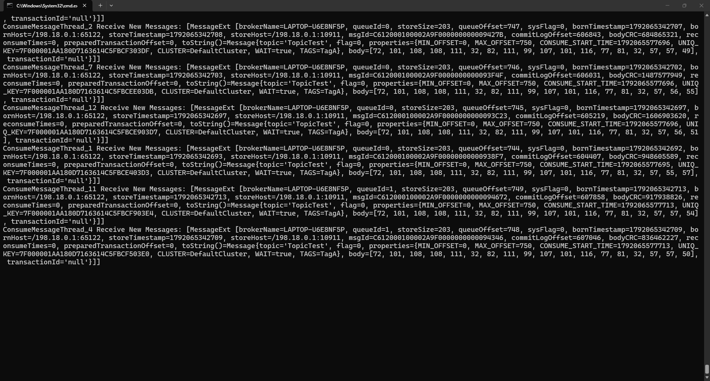

```java
ConsumeMessageThread_2 Receive New Messages:

[MessageExt [
    brokerName=LAPTOP-U6E8NF5P,
    queueId=0,
    storeSize=203,
    queueOffset=747,
    sysFlag=0,
    bornTimestamp=1792065342707,
    bornHost=/198.18.0.1:65122,
    storeTimestamp=1792065342708,
    storeHost=/198.18.0.1:10911,
    msgId=C612000100002A9F000000000009427B,
    commitLogOffset=606843,
    bodyCRC=684865321,
    reconsumeTimes=0,
    prepraredTransactionOffset=0，
    toString()=Message{...}
    
    //其中 toString()=Message{...} 这是消息内部属性
    Message {
    topic='TopicTest',
    flag=0,
    properties={
        MIN_OFFSET=0,
        MAX_OFFSET=750,
        CONSUME_START_TIME=1792065577696,
        UNIQ_KEY=...,
        CLUSTER=DefaultCluster,
        WAIT=true,
        TAGS=TagA
    },
    body=[72, 101, 108, ...],
    transactionId='null'
}
]]
```

这几个比较重要：

| 字段              | 重点理解                      |
| ----------------- | ----------------------------- |
| `queueId`         | 消息在哪个队列                |
| `queueOffset`     | 消息在队列中的逻辑位置        |
| `commitLogOffset` | 消息在 CommitLog 中的物理位置 |
| `bornTimestamp`   | 消息在生产者端产生的时间      |
| `storeTimestamp`  | 消息存储到 Broker 时的时间    |
| `reconsumeTimes`  | 消息重新消费次数              |
| `body`            | 真正的消息内容 用字节数组存储 |
| `topic`           | 消息所属 Topic                |
| `TAGS`            | 消息标签                      |
| `UNIQ_KEY`        | 客户端生成的消息唯一键        |

## RocketMQ 消费者 MessageExt 字段详解

| 字段                        | 含义                                                         |
| --------------------------- | ------------------------------------------------------------ |
| `ConsumeMessageThread_2`    | 执行消息消费任务的线程名称，后面的数字用于区分不同线程       |
| `Receive New Messages`      | 测试程序输出的提示，表示消费者收到了一批消息                 |
| `brokerName`                | 消息所在 Broker 的名称                                       |
| `queueId`                   | 消息所在的逻辑队列编号，同一个 Topic 可以拥有多个 Queue      |
| `storeSize`                 | 消息在 CommitLog 中占用的存储空间大小，单位为字节            |
| `queueOffset`               | 消息在对应 Queue 中的逻辑偏移量，从 0 开始计数               |
| `sysFlag`                   | RocketMQ 内部标志位，用于标识消息压缩、事务类型等信息        |
| `bornTimestamp`             | 消息在生产者端创建或准备发送时记录的时间戳，单位为毫秒       |
| `bornHost`                  | 生产者的网络地址，包括 IP 和端口                             |
| `storeTimestamp`            | Broker 存储消息时记录的时间戳，单位为毫秒                    |
| `storeHost`                 | 存储该消息的 Broker 的网络地址                               |
| `msgId`                     | RocketMQ 4.x 中通常表示包含 Broker 地址及 CommitLog 物理偏移量的消息 ID |
| `commitLogOffset`           | 消息在 CommitLog 中的物理存储偏移量，按字节计数              |
| `bodyCRC`                   | 消息体的 CRC32 校验值，用于检查数据是否损坏                  |
| `reconsumeTimes`            | 消息被重新消费的次数，首次正常投递通常为 0                   |
| `preparedTransactionOffset` | 与事务预备消息相关的偏移量，普通消息通常为 0                 |
| `topic`                     | 消息所属的 Topic（主题）                                     |
| `flag`                      | 消息的应用级标志位，与 `sysFlag` 不同                        |
| `properties`                | 消息扩展属性集合，包含标签、唯一键等信息                     |
| `MIN_OFFSET`                | Broker 返回的当前队列最小可用逻辑偏移量                      |
| `MAX_OFFSET`                | Broker 返回的当前队列最大逻辑偏移量边界，即下一可写位置      |
| `CONSUME_START_TIME`        | 消费端开始处理本次消息时记录的时间戳                         |
| `UNIQ_KEY`                  | RocketMQ 客户端生成的消息唯一键，用于消息追踪                |
| `CLUSTER`                   | 消息相关的 Broker 集群名称                                   |
| `WAIT`                      | 生产者发送消息时等待 Broker 存储处理结果的配置标志           |
| `TAGS`                      | 消息标签，可以用于消费者进行 Tag 过滤                        |
| `body`                      | 消息体的字节数组，使用相应字符编码解码后得到原始消息内容     |
| `transactionId`             | 事务消息 ID，普通消息通常为 null                             |


# 三、 简单示例：

> 这里只不过是简单示例，方便理解  之后会用SpringBoot搭建

先导入Maven依赖

```xml
 <dependencies>
        <dependency>
            <groupId>org.apache.rocketmq</groupId>
            <artifactId>rocketmq-client</artifactId>
            <version>4.8.0</version>
        </dependency>
    </dependencies>
```

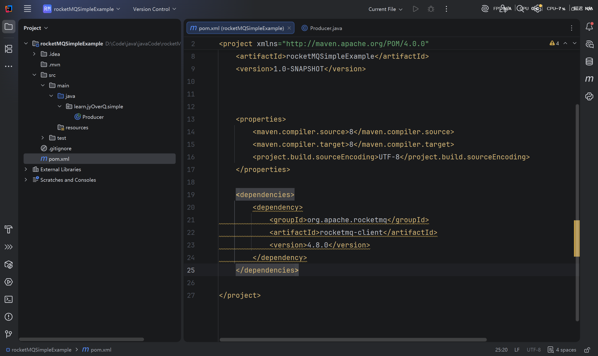

## 简单生产者：

```java
package learn.jyOverQ.simple;

import org.apache.rocketmq.client.exception.MQBrokerException;
import org.apache.rocketmq.client.exception.MQClientException;
import org.apache.rocketmq.client.producer.DefaultMQProducer;
import org.apache.rocketmq.client.producer.SendResult;
import org.apache.rocketmq.common.message.Message;
import org.apache.rocketmq.remoting.exception.RemotingException;

//一个简单的发送消息的生产者
public class Producer {
    public static void main(String[] args) throws MQClientException, MQBrokerException, RemotingException, InterruptedException {
        //1. 谁来发？ 新建一个默认的生产者 指定生产者组：
        DefaultMQProducer producer = new DefaultMQProducer("group1");
        //2. 发给谁？ 发给本机的 NameServer 它会路由到对应的Broker
        producer.setNamesrvAddr("localhost:9876");
        producer.start(); //启动生产者
        //3. 怎么发？
        //4. 发什么？ 发消息 只不过要转成字节数组
        //因为网络传输通常都是字节 底层传输和存储的单位是字节
        String msg="hello world1";
        Message message = new Message("Topic1", "tag1", msg.getBytes());
        SendResult sendResult = producer.send(message);
        //5. 发的结果是什么？
        System.out.println(sendResult);
        //6. 关闭链接
        producer.shutdown();
    }
}

```

输出结果：

```java
SendResult [sendStatus=SEND_OK, msgId=7F000001A61818B4AAC24C96134C0000, offsetMsgId=C612000100002A9F000000000009499E, messageQueue=MessageQueue [topic=Topic1, brokerName=LAPTOP-U6E8NF5P, queueId=3], queueOffset=0]
```


## 简单消费者：

```java
package learn.jyOverQ.simple;

import org.apache.rocketmq.client.consumer.DefaultMQPushConsumer;
import org.apache.rocketmq.client.consumer.listener.ConsumeConcurrentlyContext;
import org.apache.rocketmq.client.consumer.listener.ConsumeConcurrentlyStatus;
import org.apache.rocketmq.client.consumer.listener.MessageListenerConcurrently;
import org.apache.rocketmq.client.exception.MQClientException;
import org.apache.rocketmq.common.message.MessageExt;

import java.util.List;

public class Consumer {
    public static void main(String[] args) throws MQClientException {
        //1.谁来收？ 这里创建的是推送模式的Consumer也就是监听器模式  拉取模式对应的当然就是Pull
        DefaultMQPushConsumer consumer = new DefaultMQPushConsumer("group1");
        //2.从哪里收？NameServer对应的地址和端口
        consumer.setNamesrvAddr("localhost:9876");
        //3.监听哪个Topic消息？ 通过下面函数指定监听哪个Topic 第二个参数是根据tag进行筛选
        //之后还有 根据bySQL进行筛选（可以根据属性值来筛选 比如 age>18的才会到达消费者这里）
        consumer.subscribe("Topic1","*");
        //4.  注册监听器 处理对应的业务流程
        //MessageListenerConcurrently() 
        //这个监听器并发消费，处理效率高，但不保证消息处理顺序。
        consumer.registerMessageListener(new MessageListenerConcurrently() {
            @Override
            public ConsumeConcurrentlyStatus consumeMessage(List<MessageExt> list, ConsumeConcurrentlyContext consumeConcurrentlyContext) {
                //list 里面放的是MessageExt 也就是 生产者发送的消息
                //我们拿到对应的消息就可以进行处理对应的业务了
                for (MessageExt messageExt : list) {
                    System.out.println(messageExt);
                    byte[] body = messageExt.getBody();
                    System.out.println(new String(body));
                }
                //ConsumeConcurrentlyStatus 这个类是枚举类 之中只有两个属性
                //CONSUME_SUCCESS 接收成功  RECONSUME_LATER 稍后重新消费
                return ConsumeConcurrentlyStatus.CONSUME_SUCCESS;
            }
        });
        //启动消费者
        consumer.start();
        System.out.println("Consumer Started");

        //注意 这里不要关闭消费者的长连接，否则MQ中的消息无法推送过来了
    }
}
```

输出结果：

```Java
Consumer Started
MessageExt [brokerName=LAPTOP-U6E8NF5P, queueId=3, storeSize=194, queueOffset=0, sysFlag=0, bornTimestamp=1792068903757, bornHost=/198.18.0.1:55120, storeTimestamp=1792068903805, storeHost=/198.18.0.1:10911, msgId=C612000100002A9F000000000009499E, commitLogOffset=608670, bodyCRC=503566857, reconsumeTimes=0, preparedTransactionOffset=0, toString()=Message{topic='Topic1', flag=0, properties={MIN_OFFSET=0, MAX_OFFSET=1, CONSUME_START_TIME=1792078735643, UNIQ_KEY=7F000001A61818B4AAC24C96134C0000, CLUSTER=DefaultCluster, WAIT=true, TAGS=tag1}, body=[104, 101, 108, 108, 111, 32, 119, 111, 114, 108, 100, 49], transactionId='null'}]
hello world1

```

