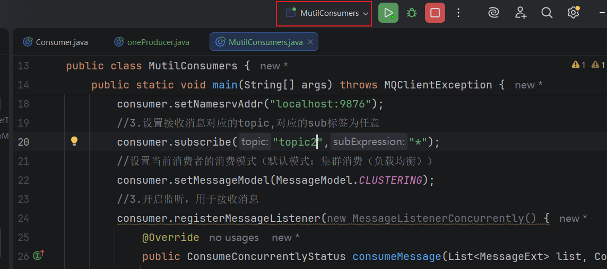
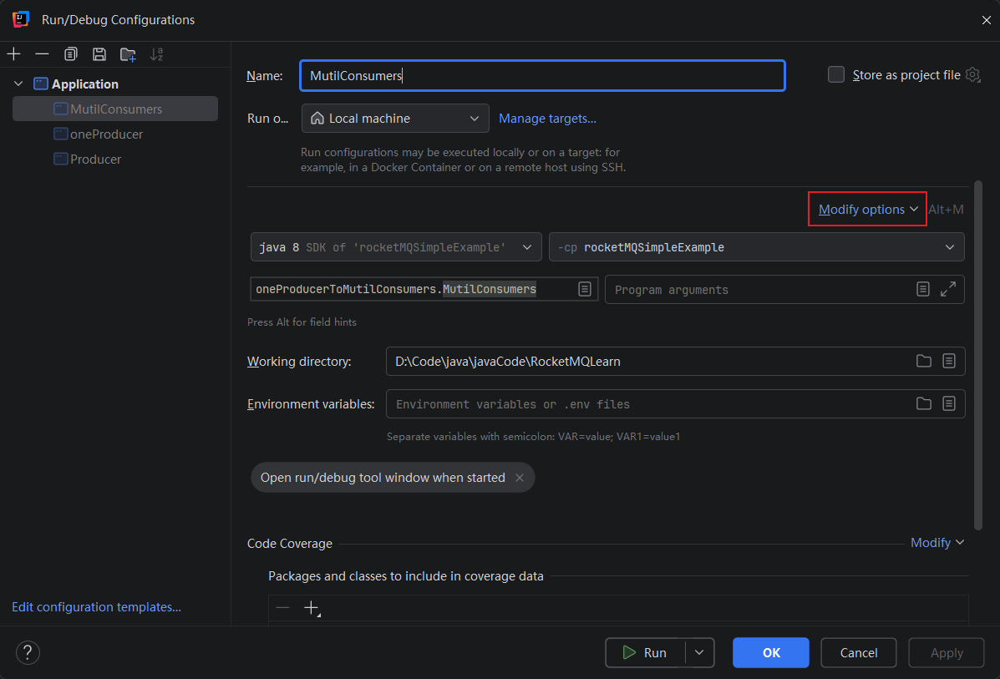
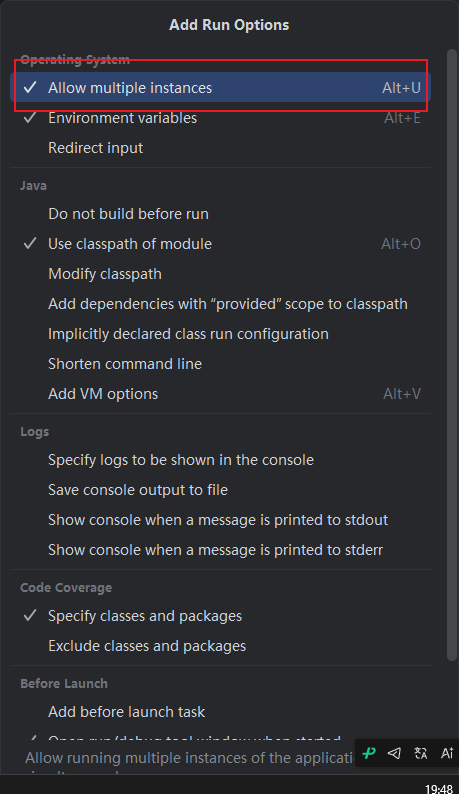
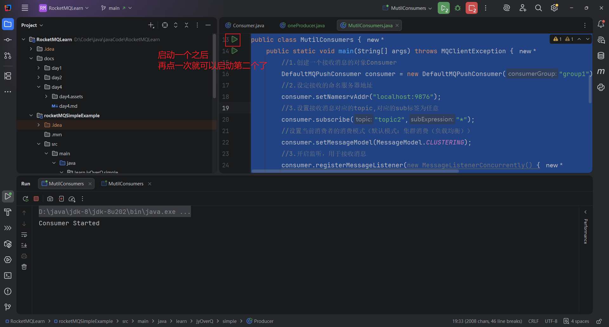
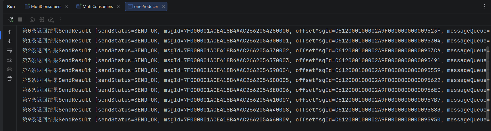
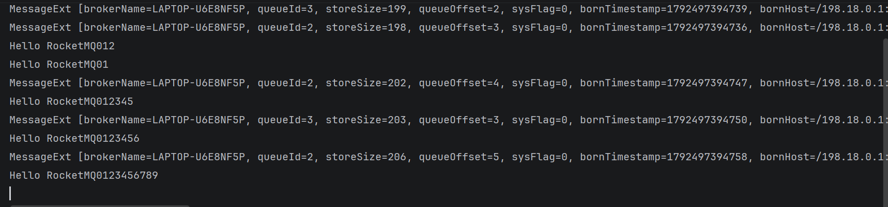
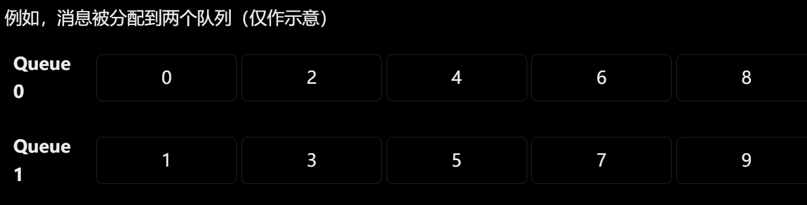
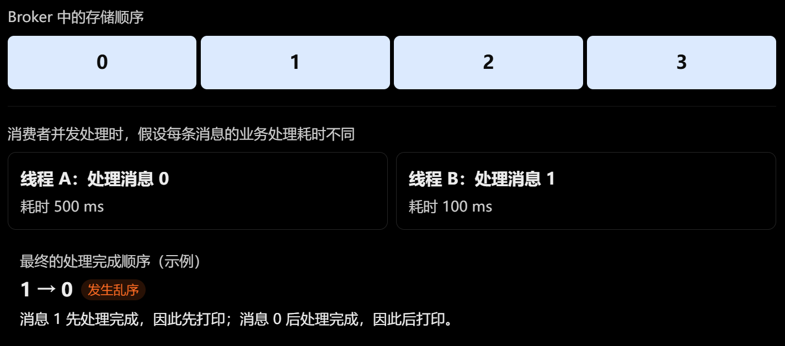

# 从零开始学 RocketMQ（二）：多消费者、多生产者与消息高级特性【保姆级教程】

上一篇我们介绍了 MQ 的基本概念、RocketMQ 的核心组件、环境搭建，以及如何使用 Java 实现简单的消息发送和接收。

本篇学习多消费者模式、多生产者模式、同步发送、异步发送、单向发送、延时消息、批量消息以及消息过滤。

> 本文示例主要采用 RocketMQ 4.x 传统 Java Client，代码中的 API 以 `rocketmq-client:4.8.0` 为参考。RocketMQ 5.x 的部分 API 和消息特性有所不同，实际使用时需要注意版本差异。

## 一、多消费者模式

### 1.1 什么是多消费者模式？

上一篇我们已经实现了一个生产者向 RocketMQ 发送消息，再由一个消费者接收消息。

但是在实际业务中，如果消息数量越来越多，仅靠一个消费者可能无法及时处理所有消息。

例如，一个订单系统每天产生大量订单事件，需要消费者执行扣减库存、增加积分等操作。如果只有一个消费者，处理能力可能成为瓶颈。

这时我们可以启动多个消费者实例，让它们共同处理消息。

在 RocketMQ 中，多消费者场景需要重点理解两种消费模式：

+ 集群消费（CLUSTERING）
+ 广播消费（BROADCASTING）

> **注意：这两种模式的区别，不在于启动了几个消费者，而在于多个消费者实例如何处理同一批消息。**

### 1.2 集群消费模式（也可以叫负载均衡）

集群消费是 RocketMQ 4.x 中的默认消费模式。

同一个 Consumer Group 中的多个消费者实例共同分担消息，而不是每个实例都收到全部消息。

假设一个 Topic 有 4 个 MessageQueue，现在启动两个消费者实例：

```
                  RocketMQ
                      |
             Topic：order_topic
                      |
          +-----------+-----------+
          |           |           |
        Queue0      Queue1      Queue2      Queue3
          |           |           |           |
          +-----+-----+           +-----+-----+
                |                       |
          Consumer A              Consumer B
```

> 这里仅用于说明队列分配的原理，实际分配结果由队列分配策略决定。

假设 Consumer A 分配到了 Queue0、Queue1，Consumer B 分配到了 Queue2、Queue3，那么它们就可以分别处理自己负责的队列中的消息。

这样做有什么好处？

假设一个消费者每秒能够处理 100 条消息，增加一个消费者后，整体处理能力可能得到提升。不过，实际吞吐量还会受到队列数量、业务处理耗时、数据库性能等因素的限制，并不是简单地增加几个消费者就一定能线性提升。

在 RocketMQ 4.x 中，可以通过下面的代码指定集群消费模式：

```java
consumer.setMessageModel(MessageModel.CLUSTERING);
```

实际上，即使不显式设置，默认也通常是集群消费模式。

### 1.3 广播消费模式

广播消费与集群消费不同。

**广播模式下，每个订阅实例都会独立消费符合条件的消息，而不是共同分担消息。**

例如，系统需要向所有在线应用实例发送配置更新通知：

```
                  RocketMQ
                      |
                config_topic
                      |
          +-----------+-----------+
          |           |           |
      Consumer A  Consumer B  Consumer C
          |           |           |
       更新配置    更新配置    更新配置
```

假设 RocketMQ 中有一条配置更新消息，在广播模式下，三个消费者实例都可以收到这条消息，并分别执行自己的配置更新逻辑。

在 RocketMQ 4.x 中，可以这样设置：

```java
consumer.setMessageModel(MessageModel.BROADCASTING);
```

广播模式适合需要让多个实例分别执行相同通知或更新操作的场景。

例如：

+ 配置更新通知
+ 本地缓存刷新
+ 某些需要每个应用实例独立处理的事件

不过需要注意，广播消费并不意味着每个实例都具备完全相同的服务端重试保障。使用时应根据具体版本确认消费失败后的处理行为，不能直接把集群消费的重试机制套用过来。

### 1.4 集群消费与广播消费有什么区别？

| 对比维度                         | 集群消费                   | 广播消费                             |
| -------------------------------- | -------------------------- | ------------------------------------ |
| 同组实例如何处理消息             | 共同分担                   | 各实例分别消费                       |
| 同一条消息是否要求每个实例都处理 | 不要求                     | 要求各订阅实例分别处理符合条件的消息 |
| 增加消费者的主要目的             | 提高整体消费能力           | 增加独立接收通知的实例               |
| 常见场景                         | 订单处理、库存任务         | 配置通知、缓存刷新                   |
| 消费失败后的处理                 | 支持相应的集群消费重试机制 | 需要特别关注广播模式的失败处理语义   |

### 1.5 同一个 Consumer Group 和不同 Consumer Group 有什么区别？

假设 Consumer A 和 Consumer B 属于同一个 Consumer Group，并且使用集群消费模式，那么它们共同分担消息。

但是，如果 Consumer A 和 Consumer B 属于不同的 Consumer Group，即使订阅同一个 Topic，通常也会各自维护消费进度，独立消费该 Topic 的消息。

例如：

```
                 Topic：order_topic
                         |
               +---------+---------+
               |                   |
          Group A              Group B
               |                   |
          Consumer A           Consumer B
```

如果 Group A 用来处理订单积分，Group B 用来发送订单通知，那么同一条订单事件可以分别被两个消费组处理。

因此需要记住：

+ **同组多实例**：通常用于分担消费任务。
+ **不同消费组**：通常用于让不同业务逻辑独立消费同一主题的消息。
+ **广播模式**：用于让同一订阅下的多个实例分别处理消息。

这三个概念不要混为一谈。

### 1.6 代码示例：

一生产者二消费者，多消费者类似：

#### 生产者：

```Java
package oneProducerToMutilConsumers;

import org.apache.rocketmq.client.exception.MQBrokerException;
import org.apache.rocketmq.client.exception.MQClientException;
import org.apache.rocketmq.client.producer.DefaultMQProducer;
import org.apache.rocketmq.client.producer.SendResult;
import org.apache.rocketmq.common.message.Message;
import org.apache.rocketmq.remoting.exception.RemotingException;

import java.io.UnsupportedEncodingException;

//单生产者
public class oneProducer {
    public static void main(String[] args) throws MQClientException, UnsupportedEncodingException, MQBrokerException, RemotingException, InterruptedException {
        //1. 首先我们要创建一个生产者
        DefaultMQProducer producer = new DefaultMQProducer("group1");
        //2. 应该给这个生产者绑定NameSever的地址
        producer.setNamesrvAddr("localhost:9876");
        //3. 启动生产者
        producer.start();
        //然后我们要发送多条消息 为了方便演示多消费者之间是如何对消息处理
        String content = "Hello RocketMQ";
        for (int i = 0; i < 10; i++) {
            content=content+i;
            //给信息指定 topic  tag  内容
            Message msg= new Message("topic2", "tag1", content.getBytes());
            SendResult sendResult = producer.send(msg);
            //打印返回结果
            System.out.println("第"+i+"条返回结果" +sendResult);
        }
        //关闭连接
        producer.shutdown();
    }

}

```

#### 多消费者：

我们应该怎么创建多个消费者?

> 写一个类，然后创建多个实例，但是默认idea不允许一个类创建多个实例
> 所以我们要改一下设置：

写好代码之后 点击一下这个类对应的配置



然后 点击 `Modify options`



勾选这个 允许多个实例：



然后点击确定

```java
package oneProducerToMutilConsumers;

import org.apache.rocketmq.client.consumer.DefaultMQPushConsumer;
import org.apache.rocketmq.client.consumer.listener.ConsumeConcurrentlyContext;
import org.apache.rocketmq.client.consumer.listener.ConsumeConcurrentlyStatus;
import org.apache.rocketmq.client.consumer.listener.MessageListenerConcurrently;
import org.apache.rocketmq.client.exception.MQClientException;
import org.apache.rocketmq.common.message.MessageExt;
import org.apache.rocketmq.common.protocol.heartbeat.MessageModel;

import java.util.List;

public class MutilConsumers {
    public static void main(String[] args) throws MQClientException {
        //1.创建一个接收消息的对象Consumer
        DefaultMQPushConsumer consumer = new DefaultMQPushConsumer("group1");
        //2.设定接收的命名服务器地址
        consumer.setNamesrvAddr("localhost:9876");
        //3.设置接收消息对应的topic,对应的sub标签为任意
        consumer.subscribe("topic2","*");
        //设置当前消费者的消费模式（默认模式：集群消费（负载均衡））
        consumer.setMessageModel(MessageModel.CLUSTERING);
        //3.开启监听，用于接收消息
        consumer.registerMessageListener(new MessageListenerConcurrently() {
            @Override
            public ConsumeConcurrentlyStatus consumeMessage(List<MessageExt> list, ConsumeConcurrentlyContext consumeConcurrentlyContext) {
                //list 里面放的是MessageExt 也就是 生产者发送的消息
                //我们拿到对应的消息就可以进行处理对应的业务了
                for (MessageExt messageExt : list) {
                    System.out.println(messageExt);
                    byte[] body = messageExt.getBody();
                    //打印消息里面真正的内容：
                    System.out.println(new String(body));
                }
                //ConsumeConcurrentlyStatus 这个类是枚举类 之中只有两个属性
                //CONSUME_SUCCESS 接收成功  RECONSUME_LATER 稍后重新消费
                return ConsumeConcurrentlyStatus.CONSUME_SUCCESS;
            }
        });
        //4. 启动消费者
        consumer.start();
        System.out.println("Consumer Started");

        //注意 这里不要关闭消费者的长连接，否则MQ中的消息无法推送过来了
    }
}
```

#### 测试：

启动两个 MutilConsumers 实例: 如图



然后我们再启动生产者，来发送消息



生产者打印出来的  发送结果

```cmd
第0条返回结果SendResult [sendStatus=SEND_OK, msgId=7F000001ACE418B4AAC2662054250000, offsetMsgId=C612000100002A9F000000000009523F, messageQueue=MessageQueue [topic=topic2, brokerName=LAPTOP-U6E8NF5P, queueId=1], queueOffset=3]
第1条返回结果SendResult [sendStatus=SEND_OK, msgId=7F000001ACE418B4AAC2662054300001, offsetMsgId=C612000100002A9F0000000000095304, messageQueue=MessageQueue [topic=topic2, brokerName=LAPTOP-U6E8NF5P, queueId=2], queueOffset=3]
第2条返回结果SendResult [sendStatus=SEND_OK, msgId=7F000001ACE418B4AAC2662054330002, offsetMsgId=C612000100002A9F00000000000953CA, messageQueue=MessageQueue [topic=topic2, brokerName=LAPTOP-U6E8NF5P, queueId=3], queueOffset=2]
第3条返回结果SendResult [sendStatus=SEND_OK, msgId=7F000001ACE418B4AAC2662054370003, offsetMsgId=C612000100002A9F0000000000095491, messageQueue=MessageQueue [topic=topic2, brokerName=LAPTOP-U6E8NF5P, queueId=0], queueOffset=2]
第4条返回结果SendResult [sendStatus=SEND_OK, msgId=7F000001ACE418B4AAC2662054390004, offsetMsgId=C612000100002A9F0000000000095559, messageQueue=MessageQueue [topic=topic2, brokerName=LAPTOP-U6E8NF5P, queueId=1], queueOffset=4]
第5条返回结果SendResult [sendStatus=SEND_OK, msgId=7F000001ACE418B4AAC26620543B0005, offsetMsgId=C612000100002A9F0000000000095622, messageQueue=MessageQueue [topic=topic2, brokerName=LAPTOP-U6E8NF5P, queueId=2], queueOffset=4]
第6条返回结果SendResult [sendStatus=SEND_OK, msgId=7F000001ACE418B4AAC26620543E0006, offsetMsgId=C612000100002A9F00000000000956EC, messageQueue=MessageQueue [topic=topic2, brokerName=LAPTOP-U6E8NF5P, queueId=3], queueOffset=3]
第7条返回结果SendResult [sendStatus=SEND_OK, msgId=7F000001ACE418B4AAC2662054410007, offsetMsgId=C612000100002A9F00000000000957B7, messageQueue=MessageQueue [topic=topic2, brokerName=LAPTOP-U6E8NF5P, queueId=0], queueOffset=3]
第8条返回结果SendResult [sendStatus=SEND_OK, msgId=7F000001ACE418B4AAC2662054440008, offsetMsgId=C612000100002A9F0000000000095883, messageQueue=MessageQueue [topic=topic2, brokerName=LAPTOP-U6E8NF5P, queueId=1], queueOffset=5]
第9条返回结果SendResult [sendStatus=SEND_OK, msgId=7F000001ACE418B4AAC2662054460009, offsetMsgId=C612000100002A9F0000000000095950, messageQueue=MessageQueue [topic=topic2, brokerName=LAPTOP-U6E8NF5P, queueId=2], queueOffset=5]
```

消费者1：



```python
Consumer Started

MessageExt [brokerName=LAPTOP-U6E8NF5P, queueId=3, storeSize=199, queueOffset=2, sysFlag=0, bornTimestamp=1792497394739, bornHost=/198.18.0.1:59071, storeTimestamp=1792497394741, storeHost=/198.18.0.1:10911, msgId=C612000100002A9F00000000000953CA, commitLogOffset=611274, bodyCRC=2041576522, reconsumeTimes=0, preparedTransactionOffset=0, toString()=Message{topic='topic2', flag=0, properties={MIN_OFFSET=0, MAX_OFFSET=3, CONSUME_START_TIME=1792497394764, UNIQ_KEY=7F000001ACE418B4AAC2662054330002, CLUSTER=DefaultCluster, WAIT=true, TAGS=tag1}, body=[72, 101, 108, 108, 111, 32, 82, 111, 99, 107, 101, 116, 77, 81, 48, 49, 50], transactionId='null'}]

MessageExt [brokerName=LAPTOP-U6E8NF5P, queueId=2, storeSize=198, queueOffset=3, sysFlag=0, bornTimestamp=1792497394736, bornHost=/198.18.0.1:59071, storeTimestamp=1792497394738, storeHost=/198.18.0.1:10911, msgId=C612000100002A9F0000000000095304, commitLogOffset=611076, bodyCRC=424236424, reconsumeTimes=0, preparedTransactionOffset=0, toString()=Message{topic='topic2', flag=0, properties={MIN_OFFSET=0, MAX_OFFSET=4, CONSUME_START_TIME=1792497394764, UNIQ_KEY=7F000001ACE418B4AAC2662054300001, CLUSTER=DefaultCluster, WAIT=true, TAGS=tag1}, body=[72, 101, 108, 108, 111, 32, 82, 111, 99, 107, 101, 116, 77, 81, 48, 49], transactionId='null'}]

Hello RocketMQ012

Hello RocketMQ01

MessageExt [brokerName=LAPTOP-U6E8NF5P, queueId=2, storeSize=202, queueOffset=4, sysFlag=0, bornTimestamp=1792497394747, bornHost=/198.18.0.1:59071, storeTimestamp=1792497394749, storeHost=/198.18.0.1:10911, msgId=C612000100002A9F0000000000095622, commitLogOffset=611874, bodyCRC=932752680, reconsumeTimes=0, preparedTransactionOffset=0, toString()=Message{topic='topic2', flag=0, properties={MIN_OFFSET=0, MAX_OFFSET=5, CONSUME_START_TIME=1792497394766, UNIQ_KEY=7F000001ACE418B4AAC26620543B0005, CLUSTER=DefaultCluster, WAIT=true, TAGS=tag1}, body=[72, 101, 108, 108, 111, 32, 82, 111, 99, 107, 101, 116, 77, 81, 48, 49, 50, 51, 52, 53], transactionId='null'}]

Hello RocketMQ012345

MessageExt [brokerName=LAPTOP-U6E8NF5P, queueId=3, storeSize=203, queueOffset=3, sysFlag=0, bornTimestamp=1792497394750, bornHost=/198.18.0.1:59071, storeTimestamp=1792497394751, storeHost=/198.18.0.1:10911, msgId=C612000100002A9F00000000000956EC, commitLogOffset=612076, bodyCRC=683297347, reconsumeTimes=0, preparedTransactionOffset=0, toString()=Message{topic='topic2', flag=0, properties={MIN_OFFSET=0, MAX_OFFSET=4, CONSUME_START_TIME=1792497394767, UNIQ_KEY=7F000001ACE418B4AAC26620543E0006, CLUSTER=DefaultCluster, WAIT=true, TAGS=tag1}, body=[72, 101, 108, 108, 111, 32, 82, 111, 99, 107, 101, 116, 77, 81, 48, 49, 50, 51, 52, 53, 54], transactionId='null'}]

Hello RocketMQ0123456

MessageExt [brokerName=LAPTOP-U6E8NF5P, queueId=2, storeSize=206, queueOffset=5, sysFlag=0, bornTimestamp=1792497394758, bornHost=/198.18.0.1:59071, storeTimestamp=1792497394760, storeHost=/198.18.0.1:10911, msgId=C612000100002A9F0000000000095950, commitLogOffset=612688, bodyCRC=1157746776, reconsumeTimes=0, preparedTransactionOffset=0, toString()=Message{topic='topic2', flag=0, properties={MIN_OFFSET=0, MAX_OFFSET=6, CONSUME_START_TIME=1792497394770, UNIQ_KEY=7F000001ACE418B4AAC2662054460009, CLUSTER=DefaultCluster, WAIT=true, TAGS=tag1}, body=[72, 101, 108, 108, 111, 32, 82, 111, 99, 107, 101, 116, 77, 81, 48, 49, 50, 51, 52, 53, 54, 55, 56, 57], transactionId='null'}]

Hello RocketMQ0123456789
```

> 可以发现消费者1 只接受到了5条消息，另外5条 在消费者2 那里，这里就不再展示了

那么我如果想让同一消费组内的每个消费者都获得订阅的Topic的全部消息，又该怎么办？

只需要改一个参数： 

```java
//设置当前消费者的消费模式（默认模式：集群消费（负载均衡））
//consumer.setMessageModel(MessageModel.CLUSTERING);
//设置当前消费者的消费模式为广播模式
 consumer.setMessageModel(MessageModel.BROADCASTING);
```

然后同一消费组内的每个消费者都会获得订阅的Topic的全部消息，这里就不演示了

> 如果 Consumer A 和 Consumer B 属于不同的 Consumer Group，即使订阅同一个 Topic，通常也会各自维护消费进度，独立消费该 Topic 的消息。

#### 生产者在放入MQ消息时，是按照顺序放的，为什么消费者取消息的时候，消息的顺序被打乱了？

第一，Topic 通常包含多个 MessageQueue，普通消息可能被分配到不同队列，不同队列之间没有全局顺序保证。



+ 每个队列内部，消息可以保持自己的存储顺序。
+ 但是，不同队列之间没有一个统一的消费顺序。

因此，即使 Queue 0 中的消息按照 `0、2、4、6、8` 存储，Queue 1 中的消息按照 `1、3、5、7、9` 存储，也不能保证消费者最终按照 `0、1、2、3……9` 的顺序处理。

第二，消费者默认可以采用并发消费模式，多个线程同时处理消息，由于处理耗时不同，最终完成顺序可能与发送顺序不同。



RocketMQ 4.x 中，如果消费者注册的是 `MessageListenerConcurrently`，就采用并发消费模式。多个消费线程可能同时处理消息，因此即使消息在 Broker 中按顺序存储，业务处理结果也不一定有序。

另外，即使使用顺序消费监听器，如果你在监听器内部又把消息提交给自己的线程池异步执行，然后立刻返回，也仍然可能发生乱序。

所以，如果业务需要保证消息顺序，就需要让相关消息进入同一个队列，并使用顺序消费模式，同时避免在业务处理过程中进行异步分发。

## 二、多生产者模式

### 2.1 什么是多生产者模式？

在实际项目中，一条业务链路往往涉及多个微服务，不同服务都可能需要向 RocketMQ 发送消息。

例如，在一个电商系统中：

+ **订单服务**：用户下单成功后，发送订单创建事件。
+ **支付服务**：用户支付成功后，发送支付成功事件。
+ **积分服务**：接收支付成功事件，为用户增加积分。
+ **通知服务**：接收订单事件，发送相关通知。

如果订单服务和支付服务都需要向 RocketMQ 发送消息，就可以分别创建自己的生产者，向同一个 Topic 发送消息。

```
              电商系统
                 |
       +---------+---------+
       |                   |
   订单服务              支付服务
       |                   |
  Producer A           Producer B
       |                   |
       +---------+---------+
                 |
              RocketMQ
                 |
          Topic：mall_events
                 |
        +--------+--------+
        |                 |
     积分服务           通知服务
     Consumer A        Consumer B
```

这里需要理解：**多生产者模式指多个生产者实例或业务服务都可以向 RocketMQ 发送消息。它们可以向同一个 Topic 发送消息，不需要每个服务单独创建一个 Topic。**

### 2.2 场景一：订单服务发送订单创建消息

假设用户在商城中成功下单，订单服务需要向 RocketMQ 发送一条订单创建事件。

首先，订单服务创建自己的 Producer。

```java
import org.apache.rocketmq.client.producer.DefaultMQProducer;
import org.apache.rocketmq.client.producer.SendResult;
import org.apache.rocketmq.common.message.Message;

import java.nio.charset.StandardCharsets;

public class OrderServiceProducer {

    public static void main(String[] args) throws Exception {

        // 创建订单服务的生产者
        DefaultMQProducer producer =
                new DefaultMQProducer("order_producer_group");

        producer.setNamesrvAddr("127.0.0.1:9876");

        try {
            producer.start();

            // 模拟用户创建订单
            String orderId = "ORDER_1001";

            String body = "订单创建成功，orderId=" + orderId;

            // 向 mall_events 发送订单创建事件
            Message message = new Message(
                    "mall_events",
                    "ORDER_CREATED",
                    body.getBytes(StandardCharsets.UTF_8)
            );

            SendResult result = producer.send(message);

            System.out.println("订单服务发送成功：" + result);

        } finally {
            producer.shutdown();
        }
    }
}
```

这里有三个关键点：

1. `order_producer_group`：订单服务使用的生产者组名称。
2. `mall_events`：消息发送到的 Topic。
3. `ORDER_CREATED`：消息的 Tag，用来表示订单创建事件。

当订单创建成功后，订单服务就可以把这个业务事件发送给 RocketMQ，而不需要直接调用所有下游服务。

### 2.3 场景二：支付服务发送支付成功消息

接下来，用户完成支付，支付服务需要发送支付成功事件。

支付服务也可以创建自己的 Producer。

```java
import org.apache.rocketmq.client.producer.DefaultMQProducer;
import org.apache.rocketmq.client.producer.SendResult;
import org.apache.rocketmq.common.message.Message;

import java.nio.charset.StandardCharsets;

public class PaymentServiceProducer {

    public static void main(String[] args) throws Exception {

        // 创建支付服务的生产者
        DefaultMQProducer producer =
                new DefaultMQProducer("payment_producer_group");

        producer.setNamesrvAddr("127.0.0.1:9876");

        try {
            producer.start();

            // 模拟用户支付成功
            String orderId = "ORDER_1001";

            String body = "订单支付成功，orderId=" + orderId;

            // 同样发送到 mall_events
            Message message = new Message(
                    "mall_events",
                    "PAYMENT_SUCCESS",
                    body.getBytes(StandardCharsets.UTF_8)
            );

            SendResult result = producer.send(message);

            System.out.println("支付服务发送成功：" + result);

        } finally {
            producer.shutdown();
        }
    }
}
```

注意，支付服务虽然创建了自己的 Producer，但它发送消息时使用的 Topic 仍然是 `mall_events`。

因此，订单服务和支付服务虽然是两个独立的业务服务，却可以共同向同一个 Topic 发送消息。

此时，RocketMQ 中的消息可以理解为：

| 消息来源 | Topic         | Tag               | 消息内容     |
| -------- | ------------- | ----------------- | ------------ |
| 订单服务 | `mall_events` | `ORDER_CREATED`   | 订单创建成功 |
| 支付服务 | `mall_events` | `PAYMENT_SUCCESS` | 订单支付成功 |

这里的 Tag 用于区分不同的业务事件，具体如何按 Tag 过滤，我们在后面的 Tag 过滤章节再详细介绍。

### 2.4 这两条消息如何被消费者处理？

假设现在有一个积分服务，需要在用户支付成功后为用户增加积分。

它可以订阅 `mall_events`，接收相关业务消息，再根据消息类型执行对应的业务逻辑。

整个过程如下：

```text
用户下单
   |
   v
订单服务 Producer A
   |
   | 发送 ORDER_CREATED
   v
RocketMQ：mall_events
   ^
   | 发送 PAYMENT_SUCCESS
   |
支付服务 Producer B


RocketMQ：mall_events
   |
   v
消费者接收消息
   |
   +---- ORDER_CREATED
   |          |
   |          v
   |      处理订单创建事件
   |
   +---- PAYMENT_SUCCESS
              |
              v
          增加用户积分
```

这样，订单服务和支付服务只需要负责发送各自的业务事件。后续新增积分服务、通知服务等消费者时，通常不需要修改这两个生产者的发送逻辑。

这就是使用消息队列进行业务解耦的一个实际例子。

### 2.5 多生产者模式需要注意什么？

**第一，多个生产者可以向同一个 Topic 发送消息。**

Topic 是消息的逻辑分类，不是某个生产者专属的资源。不同服务可以根据业务设计，共同使用一个 Topic。

**第二，Producer Group 不等于 Topic。**

示例中的 `order_producer_group` 和 `payment_producer_group` 是两个生产者组名称，而 `mall_events` 才是 Topic。

生产者组主要用于标识生产者的逻辑分组。它不是消费者的订阅条件，也不负责决定哪一个消费者接收消息。

**第三，多生产者发送不代表消息具有全局顺序。**

例如，订单服务发送了订单创建事件，支付服务随后发送了支付成功事件，但由于多个生产者可能并发发送，消息路由到不同队列，实际写入和消费顺序可能与业务事件发生顺序不同。

如果业务要求同一个订单的相关消息必须严格按照顺序处理，就需要进一步设计消息路由和顺序消费机制，不能仅仅依赖多生产者发送的先后顺序。

多生产者模式的核心就是：**多个业务服务各自使用 Producer，将业务事件发送到 RocketMQ；消费者再根据订阅关系处理这些消息。**

在上面的例子中，订单服务发送订单创建事件，支付服务发送支付成功事件，两个服务共同使用 `mall_events` 这个 Topic。

这种设计可以降低服务之间的直接依赖，让业务系统更容易扩展。

## 三、消息类型：同步、异步、单向消息

RocketMQ 4.x Java Client 常见的发送方式包括同步发送、异步发送和单向发送。

三者的主要区别是：**生产者发送消息时，是否等待发送结果，以及如何获取发送结果。**

### 3.1 同步发送

同步发送是指生产者调用发送方法后，会等待本次发送调用返回结果。

示例：

```java
Message msg = new Message(
        "topic_message",
        "同步发送消息".getBytes(StandardCharsets.UTF_8)
);
//这就是我们之前使用的方法，我们之前用的都是同步发送
SendResult result = producer.send(msg);

System.out.println(result.getSendStatus());
```

这里的 `producer.send(msg)` 会等待发送结果返回。

优点是调用方可以根据结果判断本次发送的状态。

适合需要明确发送结果的重要消息，例如订单事件、支付结果通知等。

但需要注意：

> **同步发送成功，只能说明本次发送阶段获得了相应的成功结果，并不代表消费者已经完成业务处理。**
>
> 生产者发送成功与消费者业务执行成功，是两个不同的阶段。
>

### 3.2 异步发送

异步发送不要求当前线程一直等待发送结果，而是通过回调接收发送成功或失败的通知。

示例：

```java
Message msg = new Message(
        "topic_message",
        "异步发送消息".getBytes(StandardCharsets.UTF_8)
);

producer.send(msg, new SendCallback() {

    @Override //如果成功就会执行这个方法
    public void onSuccess(SendResult result) {
        System.out.println("发送成功：" + result);
    }

    @Override //失败 抛出异常就会执行这个方法
    public void onException(Throwable e) {
        System.err.println("发送失败：" + e.getMessage());
    }
});
```

这里的两个回调分别表示：

+ `onSuccess()`：发送调用获得成功结果。
+ `onException()`：发送调用出现异常。

异步发送的优点是，调用线程不必一直等待结果返回，可以继续处理其他任务。

例如，一个服务需要连续发送大量消息，如果每次都同步等待，就可能增加整体耗时；在适合的场景下，可以使用异步发送提升效率。

> 不过要注意，示例中的生产者不能在回调执行前就被直接关闭，否则可能导致回调尚未完成。实际项目中应合理管理生产者的生命周期，并做好异常处理。
>
> 所以这种情况 就不要断开生产者与MQ的链接了

### 3.3 单向发送

单向发送是指生产者发送消息后，不等待 Broker 返回发送结果。

示例：

```java
Message msg = new Message(
        "topic_message",
        "单向发送消息".getBytes(StandardCharsets.UTF_8)
);

producer.sendOneway(msg);
```

与前两种方式相比，单向发送不需要等待发送结果，因此可以减少等待开销。

但缺点也很明显：调用方无法通过该调用获得常规的发送结果确认。

因此，单向发送更适合能够容忍发送结果未知的非关键消息，例如部分统计日志。

对于订单支付、资金变更等重要业务消息，不应该因为单向发送速度快就直接使用它。

### 3.4 三种发送方式对比

| 对比维度             | 同步发送           | 异步发送                     | 单向发送                         |
| -------------------- | ------------------ | ---------------------------- | -------------------------------- |
| 是否等待发送结果     | 是                 | 否，由回调通知               | 否                               |
| 是否获取发送结果     | 方法返回           | 回调返回                     | 不获取常规发送结果               |
| 调用线程是否需要等待 | 需要               | 通常不需要等待发送结果       | 不需要                           |
| 主要特点             | 结果明确，使用直观 | 可减少调用线程的等待         | 开销较小，但发送结果不可直接确认 |
| 典型用途             | 重要业务消息       | 需要兼顾效率和结果通知的消息 | 非关键日志等                     |

> 这里还需要区分两种容易混淆的“异步”。
>
> + **业务异步**：订单服务发送消息后，不必等待积分服务处理完成。
> + **异步发送 API**：生产者调用 `send(msg, callback)` 后，不必同步等待发送结果。
>
> 二者不是同一个概念，可以同时使用，也可以只使用其中一种。
>

## 四、延时消息

### 4.1 什么是延时消息？

延时消息是指消息发送后，不会立即对正常消费者可见，而是经过指定的延迟时间后再进入正常消费流程。

举一个电商业务的例子。

用户下单后，如果 30 分钟内没有支付，系统需要自动关闭订单。

如果没有延时消息，可能需要额外编写定时任务，定期扫描数据库中的未支付订单。

而使用延时消息，可以在创建订单时发送一条延时消息。等到延迟时间到达后，消费者再检查订单状态，决定是否关闭订单。

基本流程：

```text
用户创建订单
      |
      v
发送延时消息
      |
      v
Broker 保存消息
      |
      v
达到延迟时间
      |
      v
消费者收到消息
      |
      v
查询订单状态
      |
      +---- 已支付：不处理
      |
      +---- 未支付：执行关单逻辑
```

这里最重要的是：**延时消息负责延迟触发检查，消费者仍然需要检查真实的业务状态。**

因为用户可能在消息触发前已经完成支付，不能仅仅因为收到了延时消息，就直接关闭订单。

### 4.2 RocketMQ 4.x 如何发送延时消息？

在 RocketMQ 4.x 的经典 Java Client 中，可以使用 `setDelayTimeLevel()` 设置延时等级。

示例：

```java
Message msg = new Message(
        "topic_delay",
        "10秒后再消费".getBytes(StandardCharsets.UTF_8)
);

// 设置延时等级 3
msg.setDelayTimeLevel(3);

producer.send(msg);
```

在常见的 RocketMQ 4.x 默认延时等级配置中，Level 3 对应 10 秒。

> `setDelayTimeLevel(3)` 设置的是延时等级，而不是直接填写延时秒数。

### 4.3 RocketMQ 4.x 常见延时等级

| Level | 延时时间 | Level | 延时时间 |
| ----- | -------- | ----- | -------- |
| 1     | 1 秒     | 10    | 6 分钟   |
| 2     | 5 秒     | 11    | 7 分钟   |
| 3     | 10 秒    | 12    | 8 分钟   |
| 4     | 30 秒    | 13    | 9 分钟   |
| 5     | 1 分钟   | 14    | 10 分钟  |
| 6     | 2 分钟   | 15    | 20 分钟  |
| 7     | 3 分钟   | 16    | 30 分钟  |
| 8     | 4 分钟   | 17    | 1 小时   |
| 9     | 5 分钟   | 18    | 2 小时   |

> 以上是 RocketMQ 4.x 默认配置中的延时等级。具体时间以 Broker 的实际配置为准。
>
> 这个配置可以修改，并不是写死的
>
> 打开 Broker 的配置文件 `broker.conf`，找到或添加 `messageDelayLevel`：
>
> ```properties
> messageDelayLevel=1s 5s 10s 15s 30s 1m 2m 3m 5m 10m
> ```

### 4.4 延时消息适合哪些场景？

常见场景包括：

+ 订单超时关闭。
+ 延迟发送通知。
+ 延迟触发业务检查。
+ 一定时间后执行补偿任务。

> 不过，RocketMQ 4.x 的经典延时消息采用预定义等级，并不等于可以随意指定任意精确的延迟时间。RocketMQ 5.x 的定时和延时消息能力与 4.x 经典 API 存在差异，不能直接把上面的代码套用到所有版本。
>

## 五、批量消息

### 5.1 什么是批量消息？

前面我们每次调用 `producer.send(msg)`，发送的都是一条消息。

如果业务需要发送大量小消息，逐条发送可能会产生较多的网络请求和调用开销。

批量消息允许生产者把多条消息放在一个批次中发送，从而减少部分通信开销。

例如，我们需要发送三条消息：

```text
消息 1
消息 2
消息 3
```

逐条发送：

```text
Producer --> Broker：消息 1
Producer --> Broker：消息 2
Producer --> Broker：消息 3
```

批量发送：

```text
Producer --> Broker：消息 1 + 消息 2 + 消息 3
```

这里的示意图表示批量发送的调用方式，不代表底层所有存储和处理步骤都只执行一次。

### 5.2 如何使用 Java 发送批量消息？

RocketMQ 4.x 可以将多条消息放入一个 `List<Message>`，再调用批量发送接口。

示例：

```java
import org.apache.rocketmq.client.producer.SendResult;
import org.apache.rocketmq.common.message.Message;

import java.nio.charset.StandardCharsets;
import java.util.ArrayList;
import java.util.List;

List<Message> messages = new ArrayList<>();

messages.add(new Message(
        "topic_batch",
        "消息 1".getBytes(StandardCharsets.UTF_8)
));

messages.add(new Message(
        "topic_batch",
        "消息 2".getBytes(StandardCharsets.UTF_8)
));

messages.add(new Message(
        "topic_batch",
        "消息 3".getBytes(StandardCharsets.UTF_8)
));

SendResult result = producer.send(messages);

System.out.println(result);
```

这里假设 `producer` 已经完成配置并启动。

### 5.3 批量消息有哪些限制？

批量发送并不是把任意多条消息放进集合就可以直接发送。

RocketMQ 4.x 的经典批量消息通常需要满足以下条件：

1. **消息必须属于同一个 Topic。**
2. **消息的** `waitStoreMsgOK` **设置需要一致。**
3. **不能把延时消息直接混入普通批量消息。**
4. **批次大小需要满足对应版本的限制。经典实现通常需要遵守约 4 MB 的批量大小限制，具体以版本实现为准。**

为什么要有这些限制？

因为批量发送需要将多条消息作为一个批次处理。如果消息的目标主题或相关发送属性不一致，就可能无法按照同一批次的处理方式完成发送。

同时，如果单个批次过大，不仅会增加内存占用，还可能增加异常处理和重试的成本。

### 5.4 批量发送一定更好吗？

不一定。

批量发送适合大量、小体积、允许批量处理的消息，可以降低部分通信开销。

但对于需要立即发送、需要独立控制发送结果，或者需要特殊延迟处理的消息，逐条发送可能更合适。

因此实际项目中应根据消息大小、发送频率、延迟要求和失败处理策略选择发送方式，而不是所有消息都使用批量发送。

## 六、Tag 过滤

### 6.1 什么是 Tag？

 Topic，它用于对消息进行逻辑分类。

但是，一个 Topic 下可能还包含不同类型的消息。

例如，订单系统中有订单创建、订单支付、订单取消等事件。

如果所有消息都放在同一个 Topic 中，消费者可能只关心其中一类消息。

这时可以使用 Tag 对 Topic 下的消息进一步分类。

例如：

```text
Topic：order_topic
    |
    +---- Tag：CREATED
    |
    +---- Tag：PAID
    |
    +---- Tag：CANCELED
```

这里：

+ Topic 表示订单事件这个业务主题。
+ Tag 表示订单事件的具体类型。

> **Tag 是消息分类标签，不是一个独立的 MessageQueue，也不会因为增加 Tag 就自动增加队列。**

### 6.2 生产者如何指定 Tag？

在 RocketMQ 4.x 中，可以在创建 `Message` 时指定 Topic、Tag 和消息体。

示例：

```java
Message msg = new Message(
        "order_topic",
        "PAID", // 这里的 `"PAID"` 就是消息的 Tag。
        "订单支付成功".getBytes(StandardCharsets.UTF_8)
);

producer.send(msg);
```

这里的 `"PAID"` 就是消息的 Tag。

生产者可以根据业务事件的类型设置不同标签，例如：

+ `CREATED`：订单创建。
+ `PAID`：订单支付。
+ `CANCELED`：订单取消。

### 6.3 消费者如何按 Tag 过滤？

假设消费者只关心订单支付成功和订单取消事件，可以在订阅时指定标签表达式。

```java
consumer.subscribe(
        "order_topic",
        "PAID || CANCELED" //这里就是筛选的条件表达式，之前都是用的*，之前接收所有Tag的消息
);
```

这里的 `||` 表示逻辑或。

也就是说，只要消息的 Tag 是 `PAID` 或 `CANCELED`，就符合该订阅条件。

如果希望接收这个 Topic 下所有 Tag 的消息，可以使用：

```java
consumer.subscribe("order_topic", "*");
```

### 6.4 Tag 过滤有什么作用？

假设一个 Topic 中包含很多种业务事件：

```text
order_topic
    |
    +---- CREATED
    +---- PAID
    +---- CANCELED
    +---- REFUNDED
```

不同消费者可以按自己的业务需求订阅相应的消息类型。

例如：

| 消费者     | 订阅 Tag   | 业务功能           |
| ---------- | ---------- | ------------------ |
| 积分消费者 | `PAID`     | 支付成功后增加积分 |
| 订单消费者 | `CANCELED` | 处理订单取消       |
| 统计消费者 | `*`        | 接收所有订单事件   |

这样可以避免每个消费者都接收自己完全不需要的消息。

> 需要注意，Tag 过滤通常基于消息标签进行匹配。如果业务需要按照多个动态属性组合筛选消息，仅使用 Tag 可能不够灵活，这时可以考虑 SQL 属性过滤。
>

## 七、SQL 过滤

### 7.1 为什么已经有 Tag 了，还需要 SQL 过滤？

Tag 可以根据消息类别进行过滤，但业务有时需要按照多个属性组合筛选消息。

例如，我们需要向满足以下条件的用户发送特定消息：

+ 用户年龄大于等于 18 岁。
+ 用户是 VIP 用户。

如果只使用 Tag，我们可能需要提前设计更多的标签组合。

但如果需要根据多个属性动态组合条件，标签数量就可能越来越多。

因此，RocketMQ 4.x 还提供了 SQL92 属性过滤能力，可以根据消息的用户属性表达式筛选消息。

### 7.2 生产者如何设置消息属性？

先创建一条消息，并为它添加用户属性。

```java
Message msg = new Message(
        "topic_sql",
        "用户相关消息".getBytes(StandardCharsets.UTF_8)
);

// 添加消息属性
msg.putUserProperty("vip", "1");
msg.putUserProperty("age", "20");

producer.send(msg);
```

这里添加了两个属性：

| 属性  | 示例值 | 含义            |
| ----- | ------ | --------------- |
| `vip` | `"1"`  | 是否为 VIP 用户 |
| `age` | `"20"` | 用户年龄        |

> **这些属性属于消息的扩展属性，并不是消息体本身。**

### 7.3 消费者如何使用 SQL 表达式过滤？

假设消费者只想接收 VIP 用户且年龄大于等于 18 岁的消息，可以使用 `MessageSelector.bySql()`。

示例：

```java
consumer.subscribe(
        "topic_sql",
        MessageSelector.bySql("age >= 18 AND vip = '1'")
);
```

表示消息需要同时满足两个条件：

1. `age >= 18`：年龄大于等于 18。
2. `vip = '1'`：VIP 属性等于字符串 `'1'`。

这里使用 `AND` 连接两个条件，因此只有同时满足条件的消息才符合该过滤表达式。

### 7.4 SQL 过滤支持哪些表达式？

RocketMQ 4.x 的 SQL92 过滤支持常见的比较、逻辑和空值判断表达式，例如：

| 表达式        | 含义                 |
| ------------- | -------------------- |
| `>`           | 大于                 |
| `>=`          | 大于等于             |
| `<`           | 小于                 |
| `<=`          | 小于等于             |
| `=`           | 等于                 |
| `<>`          | 不等于               |
| `BETWEEN`     | 判断是否位于指定范围 |
| `IN`          | 判断是否属于指定集合 |
| `IS NULL`     | 判断属性是否为空值   |
| `IS NOT NULL` | 判断属性是否不为空值 |
| `AND`         | 逻辑与               |
| `OR`          | 逻辑或               |
| `NOT`         | 逻辑非               |

### 7.5 SQL 过滤需要注意什么？

首先，Broker 需要支持并开启相应的属性过滤功能。

在 RocketMQ 4.x 的经典实现中，可以检查 Broker 配置文件中的：

```java
enablePropertyFilter=true
```

修改配置后，需要按照当前版本的部署方式重新加载或重启 Broker，并确认配置确实生效。

> 消费者订阅的 SQL 表达式必须符合支持的语法，消息也需要包含表达式中涉及的属性。
>
> SQL 过滤并不是让 RocketMQ 变成一个通用数据库。它适合根据消息属性进行订阅过滤，但不适合代替数据库完成复杂查询、模糊检索或任意业务数据分析。

### 7.6 Tag 过滤与 SQL 过滤有什么区别？

| 对比维度   | Tag 过滤           | SQL 属性过滤           |           |                           |
| ---------- | ------------------ | ---------------------- | --------- | ------------------------- |
| 过滤依据   | 消息 Tag           | 消息用户属性           |           |                           |
| 使用方式   | 按标签匹配         | 按属性表达式匹配       |           |                           |
| 适合场景   | 按业务事件类型筛选 | 按多个业务属性组合筛选 |           |                           |
| 配置复杂度 | 较低               | 相对较高               |           |                           |
| 示例       | `PAID || CANCELED` | `age >= 18 AND vip = '1'` |||

简单来说：

**如果只需要区分消息类型，优先考虑 Tag；如果需要根据多个消息属性组合筛选，可以考虑 SQL 过滤。**

## 八、本篇总结

主要学习了 RocketMQ 中几种常见的消息消费和发送方式，以及消息过滤能力。

这里把核心知识点简单总结一下。

1. **多消费者模式**：集群消费主要用于分担消息，广播消费用于让多个订阅实例分别处理符合条件的消息。
2. **多生产者模式**：多个生产者可以向同一个 Topic 发送消息，消费者按照订阅关系和消费模式处理消息。
3. **同步、异步、单向发送**：区别在于发送调用是否等待结果，以及如何获得发送结果。
4. **延时消息**：延迟消息进入正常消费流程的时间，适合订单超时检查等场景。
5. **批量消息**：一次发送多条消息，减少部分通信开销，但需要满足相应的批量限制。
6. **Tag 过滤**：根据消息标签筛选消息，适合按业务类型分类。
7. **SQL 过滤**：根据消息属性表达式筛选消息，适合多属性组合过滤。

最后留几个问题，可以检查一下自己是否真正理解了本篇内容：

+ 为什么集群消费模式下，同一 Consumer Group 的多个消费者不会各自收到全部消息？
+ 同一个 Topic 被不同 Consumer Group 订阅时，为什么可以分别处理同一条业务事件？
+ 同步发送成功，是否意味着消费者已经处理成功？
+ RocketMQ 4.x 的延时消息为什么使用 `setDelayTimeLevel()`，而不是直接传入任意秒数？
+ 批量发送为什么需要限制消息的 Topic 和批次大小？
+ Tag 过滤与 SQL 属性过滤分别适合什么场景？

### 参考答案：

#### **1. 为什么集群消费模式下，同一个 Consumer Group 的多个消费者不会各自收到全部消息？**

因为集群消费模式采用负载均衡机制，同一个 Consumer Group 中的多个消费者会共同分担消息。RocketMQ 通过队列分配策略，将不同的 MessageQueue 分配给不同的消费者实例，从而实现并行消费，提高整体消费能力。

#### **2. 同一个 Topic 被不同 Consumer Group 订阅时，为什么可以分别处理同一条业务事件？**

因为不同的 Consumer Group 拥有独立的消费进度，可以分别消费同一个 Topic 中符合各自订阅条件的消息。例如，订单支付成功后，积分服务可以增加用户积分，通知服务可以发送支付通知，而订单服务只需要发送一次消息即可。

> 这也就是，为什么消息不会在被消费之后立马就从MQ中删掉，因为可能还会有其他消费者需要这条消息。

#### **3. 同步发送成功，是否意味着消费者已经处理成功？**

不意味着。同步发送成功表示生产者获得了本次发送的成功结果，并不代表消费者已经完成业务处理。消息发送成功与消费者业务处理成功是两个不同的阶段。

#### **4. RocketMQ 4.x 的延时消息为什么使用** `setDelayTimeLevel()`**，而不是直接传入任意秒数？**

因为 RocketMQ 4.x 经典延时消息采用预定义的延时等级，具体延时时间由 Broker 的 `messageDelayLevel` 配置决定，生产者通过 `setDelayTimeLevel()` 指定等级即可。这种机制不支持通过该 API 任意指定延迟秒数。

> 可以修改Broker`messageDelayLevel` 配置，自定义延时等级及对应时间，但是生产者只能通过`setDelayTimeLevel()` 指定等级。

#### **5. 批量发送为什么需要限制消息的 Topic 和批次大小？**

因为同一批次中的消息需要满足批量发送接口的要求，RocketMQ 4.x 经典批量发送通常要求消息属于同一个 Topic，并且批次大小需要符合版本限制。合理限制批次大小，可以避免请求过大带来的内存、网络和处理压力。

#### **6. Tag 过滤与 SQL 属性过滤分别适合什么场景？**

Tag 过滤适合按照消息类型进行筛选，例如只消费 `PAID` 标签的支付成功消息；SQL 属性过滤则适合根据多个消息属性组合筛选，例如使用 `age >= 18 AND vip = '1'` 过滤符合条件的消息。简单来说，按消息类型筛选优先考虑 Tag，按多个属性组合筛选可以考虑 SQL 过滤。