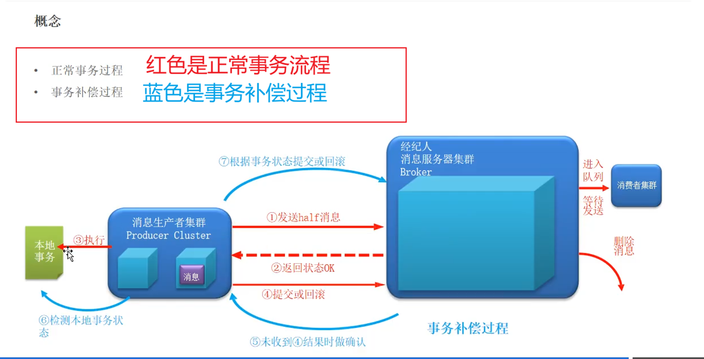
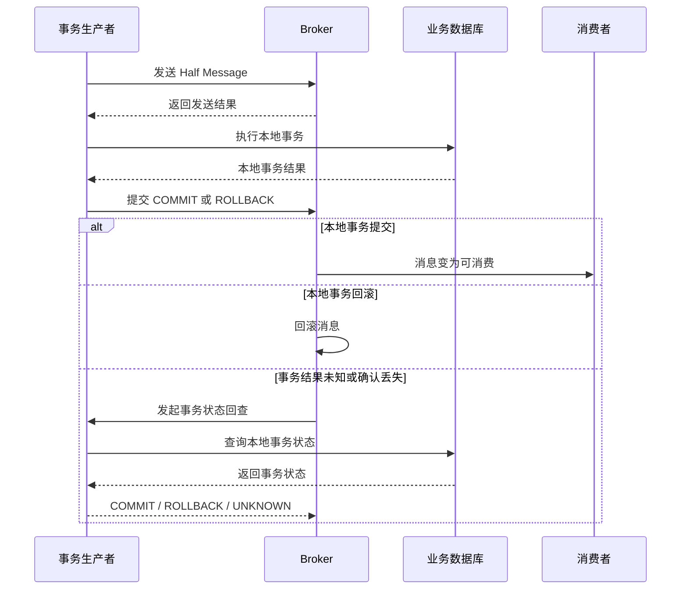
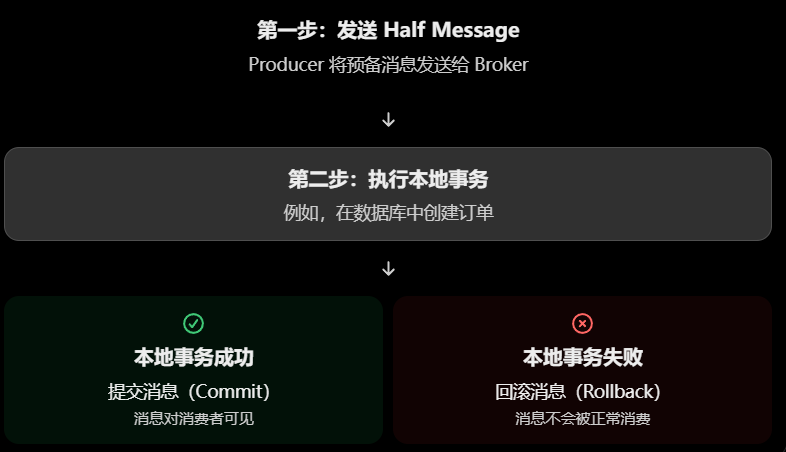

# 从零开始学 RocketMQ（三）：Spring Boot 整合、顺序消息与事务消息【保姆级教程】

前两篇我们学习了 RocketMQ 的基本概念、环境搭建、消息收发，以及多生产者、多消费者、延时消息、批量消息和消息过滤等功能。

这篇主要包括 Spring Boot 整合 RocketMQ、顺序消息和事务消息。

其中，顺序消息主要解决消息处理顺序的问题，而事务消息主要解决本地业务事务与消息发送之间的一致性问题。

> **版本说明：** 本文使用的 `rocketmq-spring-boot-starter:2.0.3`，以及 RocketMQ 4.x 的传统 Java Client。实际项目使用时，需要根据 Java、Spring Boot 和 RocketMQ 服务端版本检查兼容性，不能直接将旧版示例套用到 RocketMQ 5.x 新 SDK。

## 一、Spring Boot 整合 RocketMQ：生产者

### 1.1 为什么需要整合 Spring Boot？

上一篇我们已经通过 `DefaultMQProducer` 实现了消息发送。

传统方式需要自己创建 Producer、设置 NameServer 地址、调用 `start()`，并在适当的时候关闭生产者。

在 Spring Boot 项目中，我们可以通过 Starter 自动配置生产者，并使用 `RocketMQTemplate` 发送消息。

这样可以减少手动管理客户端对象的工作量，也更方便与 Controller、Service 等业务代码整合。

### 1.2 添加 Maven 依赖

首先，在 Spring Boot 项目的 `pom.xml` 中添加 RocketMQ Starter 依赖：

```xml
<dependency>
    <groupId>org.apache.rocketmq</groupId>
    <artifactId>rocketmq-spring-boot-starter</artifactId>
    <version>2.0.3</version>
</dependency>
```

> 如果使用其他 Spring Boot 版本，需要先确认 Starter 的兼容性。

### 1.3 配置 NameServer 和生产者组

在 `application.properties` 中添加：

```properties
# NameServer 地址
rocketmq.name-server=127.0.0.1:9876

# 生产者组
rocketmq.producer.group=demo_producer_group

# 消息发送超时时间
rocketmq.producer.send-message-timeout=3000
```

这几个配置分别表示：

| 配置项                                   | 作用                                               |
| ---------------------------------------- | -------------------------------------------------- |
| `rocketmq.name-server`                   | 指定 NameServer 地址，供客户端获取 Broker 路由信息 |
| `rocketmq.producer.group`                | 指定生产者组名称                                   |
| `rocketmq.producer.send-message-timeout` | 设置发送消息的超时时间，单位为毫秒                 |

> 注意，NameServer 是路由发现服务，真正负责接收和存储消息的是 Broker。

### 1.4 编写生产者

接下来创建一个 Controller，通过 HTTP 请求触发消息发送。

```java
import org.apache.rocketmq.spring.core.RocketMQTemplate;
import org.springframework.web.bind.annotation.GetMapping;
import org.springframework.web.bind.annotation.RequestMapping;
import org.springframework.web.bind.annotation.RestController;

@RestController
@RequestMapping("/mq")
public class DemoProducerController {

    private final RocketMQTemplate rocketMQTemplate;

    public DemoProducerController(RocketMQTemplate rocketMQTemplate) {
        this.rocketMQTemplate = rocketMQTemplate;
    }

    @GetMapping("/send")
    public String sendMessage() {

        // 向 demo-topic 发送消息
        rocketMQTemplate.convertAndSend(
                "demo-topic", //指定Topic
                "Hello RocketMQ" //消息内容
        );

        return "消息发送成功";
    }
}
```


**`RocketMQTemplate` **是什么？

它是 RocketMQ Spring 集成提供的消息发送模板，封装了底层生产者的使用过程，可以直接发送字符串、对象或 Spring Message 等消息内容。

> 这是Spring创建的模板，其他中间件也有，比如Redis 也会有RedisTemplate

`convertAndSend()` 做了什么？

它将消息内容转换为 Spring 消息，再交给底层发送逻辑处理。对于这里的字符串示例，可以直接发送 `"Hello RocketMQ"`。

> 这里的调用采用同步发送路径：发送调用会等待发送结果返回，但并不等待消费者完成业务处理。

### 1.5 测试消息发送

启动 RocketMQ 的 NameServer、Broker，再启动 Spring Boot 项目。

浏览器访问：

```http
http://localhost:8080/mq/send
```

如果配置和发送过程正常，接口会返回：

```
消息发送成功
```

> 不过要注意，HTTP 接口返回成功只能说明当前代码正常执行到了返回语句；如果要把接口返回作为严格的发送成功确认，应确保发送异常没有被吞掉，并结合实际发送结果进行处理。

## 二、Spring Boot 整合 RocketMQ：消费者

### 2.1 为什么消费者也可以通过 Spring Boot 整合？

生产者负责发送消息，消费者负责接收和处理消息。

在传统 Java Client 中，我们需要创建 `DefaultMQPushConsumer`、订阅 Topic、注册监听器，再启动消费者。

Spring Boot 则可以通过 `@RocketMQMessageListener` 注解声明监听关系，由框架管理消费者的创建和生命周期。

### 2.2 编写消费者

新建一个 `DemoConsumer` 类：

```java
import org.apache.rocketmq.spring.annotation.RocketMQMessageListener;
import org.apache.rocketmq.spring.core.RocketMQListener;
import org.springframework.stereotype.Service;

@Service
//添加一个监听器，指定订阅的Topic 消费者组consumerGroup
@RocketMQMessageListener(
        topic = "demo-topic",
        consumerGroup = "demo_consumer_group"
)
public class DemoConsumer implements RocketMQListener<String> {

    @Override
    public void onMessage(String message) {

        System.out.println("收到 RocketMQ 消息：" + message);

        // 在这里编写真正的业务处理逻辑
    }
}
```


**1.** `@Service`

将消费者注册为 Spring Bean，让 Spring 容器管理它。

**2.** `@RocketMQMessageListener`

通过注解声明订阅关系：

+ `topic`：指定要订阅的 Topic。
+ `consumerGroup`：指定消费者组。

**3.** `RocketMQListener<String>`

表示该监听器接收的消息内容按照 `String` 类型处理。

当消费者收到符合订阅条件的消息时，框架会调用 `onMessage()` 方法。

### 2.3 生产者和消费者如何配合？

前面的生产者向 `demo-topic` 发送：

```
Hello RocketMQ
```

消费者订阅的也是 `demo-topic`，因此符合订阅条件的消息会交给消费者处理。

整体流程如下：

```
HTTP 请求
    |
    v
DemoProducerController
    |
    v
RocketMQTemplate
    |
    v
RocketMQ Broker
    |
    v
DemoConsumer
    |
    v
onMessage()
    |
    v
执行业务逻辑
```

> 需要注意，生产者组与消费者组承担不同的作用，两者不需要使用相同的名称。
>
> 此外，消费者业务处理失败时，不要捕获异常后直接忽略，否则框架可能认为本次处理正常结束。

## 三、Spring Boot 整合 RocketMQ：其他设置

### 3.1 异步发送

如果希望发送消息时不让当前业务线程一直等待发送结果，可以使用 `asyncSend()`。

```java
import org.apache.rocketmq.client.producer.SendCallback;
import org.apache.rocketmq.client.producer.SendResult;

rocketMQTemplate.asyncSend(
        "demo-topic",
        "异步发送消息",
        new SendCallback() {

            @Override
            public void onSuccess(SendResult result) {
                System.out.println("发送成功：" + result);
            }

            @Override
            public void onException(Throwable e) {
                System.err.println("发送失败：" + e.getMessage());
            }
        }
);
```

这里有两个回调：

+ `onSuccess()`：发送调用获得成功结果。
+ `onException()`：发送调用出现异常。

异步发送可以减少调用线程等待发送结果的时间，但需要注意异常处理和生产者的生命周期。

### 3.2 单向发送

如果业务不需要获取常规的发送结果，可以使用单向发送：

```java
rocketMQTemplate.sendOneWay(
        "demo-topic",
        "单向发送消息"
);
```

单向发送不等待 Broker 返回发送结果，因此调用开销较小。

不过，这也意味着调用方无法通过该方法确认本次发送是否成功，不适合对可靠性要求很高的关键业务消息。

### 3.3 Spring Boot 中发送延时消息

课程中还演示了 Spring Boot 下的延时消息发送。

在对应的 RocketMQ 4.x Starter 版本中，可以使用带有延时等级参数的 `syncSend()`：

```java
import org.springframework.messaging.support.MessageBuilder;

rocketMQTemplate.syncSend(
        "demo-delay-topic",
        MessageBuilder.withPayload("延时消息").build(),
        3000,  
        2 //延时等级 
);
```

这里的参数含义是：

+ `"demo-delay-topic"`：目标 Topic。
+ `"延时消息"`：消息内容。
+ `3000`：发送超时时间，单位为毫秒。
+ `2`：延时等级。

在常见的 RocketMQ 4.x 默认延时等级配置中，Level 2 对应 5 秒。

注意，这里的 `2` 不是 2 秒。经典 RocketMQ 4.x 延时消息使用的是预定义等级，具体时间由 Broker 配置决定。

### 3.4 使用 Tag 过滤

假设生产者发送带有 `tagA` 的消息：

```java
rocketMQTemplate.convertAndSend(
        "demo-topic:tagA",
        "带有 tagA 的消息"
);
```

消费者可以指定只接收 `tagA`：

```java
@RocketMQMessageListener(
        topic = "demo-topic",
        consumerGroup = "tag_consumer_group",
        selectorExpression = "tagA"
)
```

这样可以按照消息标签区分业务事件。

### 3.5 使用 SQL 属性过滤

如果需要根据消息属性筛选消息，可以在监听器上配置 SQL92 过滤。

```java
@RocketMQMessageListener(
        topic = "demo-topic",
        consumerGroup = "sql_consumer_group",
        selectorType = SelectorType.SQL92,
        selectorExpression = "age >= 18"
)
```

该示例表示消费者只接收满足 `age >= 18` 条件的消息。

使用前需要确认 Broker 已启用属性过滤功能，并确保生产者确实为消息设置了相应的用户属性。

### 3.6 设置广播消费模式

默认情况下，RocketMQ 4.x 消费者通常采用集群消费模式。

如果希望同一消费组中的每个实例都分别消费符合条件的消息，可以使用广播模式：

```java
@RocketMQMessageListener(
        topic = "demo-topic",
        consumerGroup = "broadcast_consumer_group",
        messageModel = MessageModel.BROADCASTING
)
```

广播模式适用于需要多个应用实例分别处理同一通知的场景，例如配置更新。

需要注意，广播消费的失败处理语义与集群消费不同，不能直接认为它具备相同的服务端消费重试保障。

以上示例是不同的配置片段，实际使用时应分别放到对应的消费者类中。

## 四、顺序消息错误演示

> 这个其实在第二篇里面讲过了，可以复习一下

### 4.1 什么是顺序消息？

假设一个订单会依次产生以下事件：

```text
创建订单 → 支付订单 → 完成订单
```

业务要求同一个订单必须按照这个顺序处理。

如果消费者先处理了“完成订单”，随后才处理“创建订单”，就可能造成业务状态错误。

因此，我们需要研究如何让消息按照预期的顺序被消费。

### 4.2 为什么按顺序发送，消费时仍然可能乱序？

假设我们向 RocketMQ 连续发送 10 条消息，消息编号依次为 0～9。

```java
for (int i = 0; i < 10; i++) {

    String body = "订单1001，步骤：" + i;

    Message message = new Message(
            "order_topic",
            "ORDER",
            body.getBytes(StandardCharsets.UTF_8)
    );

    SendResult result = producer.send(message);

    System.out.printf(
            "发送消息：%d，queueId=%d，queueOffset=%d%n",
            i,
            result.getMessageQueue().getQueueId(),
            result.getQueueOffset()
    );
}
```

这里没有指定目标队列，因此生产者会按照默认的队列选择策略，将不同消息发送到可用队列中。

假设 Topic 有 4 个队列，消息可能被分配为：

```text
Queue0：0、4、8
Queue1：1、5、9
Queue2：2、6
Queue3：3、7
```

注意，这只是说明默认多队列发送时可能出现的分布，不是所有运行环境下都固定如此。

现在，消费者采用并发监听方式：

```java
consumer.registerMessageListener(
        (MessageListenerConcurrently) (messages, context) -> {

            for (MessageExt message : messages) {
                String body = new String(
                        message.getBody(),
                        StandardCharsets.UTF_8
                );

                System.out.printf(
                        "线程=%s，queueId=%d，消息=%s%n",
                        Thread.currentThread().getName(),
                        message.getQueueId(),
                        body
                );
            }

            return ConsumeConcurrentlyStatus.CONSUME_SUCCESS;
        }
);
```

由于不同队列可能被并行处理，不同消费线程的执行速度也可能不同，所以最终的日志输出顺序可能不是 0、1、2……9。

### 4.3 问题到底出在哪里？

主要有两个原因：

**第一，生产者把消息发送到了不同的队列。**

每个 MessageQueue 都有自己的队列顺序。不同队列之间不存在一个由 RocketMQ 自动保证的全局消息顺序。

**第二，消费者采用并发消费方式。**

`MessageListenerConcurrently` 允许不同消息批次并发处理。即使生产者按照某个顺序发出消息，不同线程也可能因为调度和业务处理耗时的差异，导致最终处理完成的顺序发生变化。

因此：

> 发送顺序正确，并不代表跨队列的消费顺序和业务处理完成顺序一定正确。

如果业务确实需要顺序消费，就不能只依赖生产者的发送先后顺序，还需要设计队列路由和消费方式。

## 五、顺序消息发送演示

### 5.1 正确的思路：同一业务键固定到同一个队列

在实际业务中，通常不需要所有订单之间都保持全局顺序，而是要求同一个订单内部有序。

例如：

```text
订单1001：创建 → 支付 → 完成
订单1002：创建 → 支付 → 完成
```

订单 1001 和订单 1002 之间可以并行处理，但每个订单内部必须保持顺序。

因此，可以根据 `orderId` 选择队列，让同一个订单的消息始终进入同一个 MessageQueue。

### 5.2 使用 MessageQueueSelector

RocketMQ 4.x 传统 Java Client 提供了 `MessageQueueSelector`，可以由生产者自定义队列选择逻辑。

下面是一个示例：

```java
import org.apache.rocketmq.client.producer.DefaultMQProducer;
import org.apache.rocketmq.common.message.Message;
import org.apache.rocketmq.common.message.MessageQueue;

import java.nio.charset.StandardCharsets;
import java.util.List;

public class OrderProducer {

    public static void main(String[] args) throws Exception {

        DefaultMQProducer producer =
                new DefaultMQProducer("order_producer_group");

        producer.setNamesrvAddr("127.0.0.1:9876");
        producer.start();

        try {
            sendOrderEvent(producer, 1001L, "创建");
            sendOrderEvent(producer, 1002L, "创建");

            sendOrderEvent(producer, 1001L, "支付");
            sendOrderEvent(producer, 1002L, "支付");

            sendOrderEvent(producer, 1001L, "完成");
            sendOrderEvent(producer, 1002L, "完成");

        } finally {
            producer.shutdown();
        }
    }

    private static void sendOrderEvent(
            DefaultMQProducer producer,
            long orderId,
            String event
    ) throws Exception {

        String body = "订单号：" + orderId + "，事件：" + event;

        Message message = new Message(
                "order_topic",
                "ORDER",
                body.getBytes(StandardCharsets.UTF_8)
        );

        // 使用订单 ID 选择队列
        producer.send(
                message,
                (queues, msg, arg) -> {
                    long id = (Long) arg;
                // Java 8 的 floorMod(long, long) 返回 long，取模后再转换为队列索引。
                    int index = Math.floorMod(id, queues.size());
                    return queues.get(index);
                },
                orderId
        );
    }
}
```

关键代码是：

```java
int index = Math.floorMod(id, queues.size());
return queues.get(index);
```

它根据订单 ID 计算队列索引。同一个订单 ID 在队列列表稳定的情况下，会选择相同的队列。

例如：

```text
订单1001 → Queue1
订单1002 → Queue2
订单1001 → Queue1
订单1002 → Queue2
```

这样，同一订单的消息就不会因为默认队列轮询而分散到不同队列。

> 需要注意，取模只是教学示例。生产环境中如果队列数量变化，简单取模可能改变订单对应的队列，需要考虑稳定的分区映射策略。

### 5.3 消费者使用顺序监听器

生产者固定队列后，消费者还需要使用顺序消费方式。

```java
import org.apache.rocketmq.client.consumer.DefaultMQPushConsumer;
import org.apache.rocketmq.client.consumer.listener.ConsumeOrderlyStatus;
import org.apache.rocketmq.client.consumer.listener.MessageListenerOrderly;
import org.apache.rocketmq.common.message.MessageExt;

import java.nio.charset.StandardCharsets;

public class OrderConsumer {

    public static void main(String[] args) throws Exception {

        DefaultMQPushConsumer consumer =
                new DefaultMQPushConsumer("order_consumer_group");

        consumer.setNamesrvAddr("127.0.0.1:9876");
        consumer.subscribe("order_topic", "*");

        consumer.registerMessageListener(
                (MessageListenerOrderly) (messages, context) -> {

                    try {
                        for (MessageExt message : messages) {

                            String body = new String(
                                    message.getBody(),
                                    StandardCharsets.UTF_8
                            );

                            System.out.println("顺序消费：" + body);
                        }

                        return ConsumeOrderlyStatus.SUCCESS;

                    } catch (Exception e) {

                        e.printStackTrace();

                        return ConsumeOrderlyStatus
                                .SUSPEND_CURRENT_QUEUE_A_MOMENT;
                    }
                }
        );

        consumer.start();

        System.out.println("顺序消费者已启动");
    }
}
```

这里使用了 `MessageListenerOrderly`，它会按照顺序消费机制处理分配给当前消费者的队列。

### 5.4 顺序消息需要满足什么条件？

顺序消息不是简单地把监听器换成 `MessageListenerOrderly` 就能实现。

需要同时满足几个条件：

1. **生产者路由一致：** 同一业务键的消息进入同一个队列。
2. **消费者顺序处理：** 使用顺序消费机制，避免同一队列内的消息并发处理。
3. **生产顺序正确：** 上游必须保证同一业务键的事件按正确顺序提交和发送。
4. **考虑并发生产者：** 如果多个生产者同时发送同一订单的事件，仍然需要业务层保证事件顺序。

例如，即使订单的“支付”消息和“创建”消息都被路由到同一个队列，如果多个生产者并发发送，支付消息仍有可能先到达 Broker。

因此，顺序消息的核心可以总结为：

**同一业务键固定队列 + 顺序消费 + 上游正确排序。**

另外，全局顺序要求所有相关消息都严格按顺序处理，通常会限制并行度；实际业务更常用的是同一订单、同一账户等业务键范围内的局部顺序。

## 六、事务消息流程

顺序消息解决的是处理顺序问题，事务消息解决的则是另一个问题：如何让本地业务事务与消息发送保持一致。

### 6.1 为什么需要事务消息？

假设我们正在开发一个电商系统。

用户下单时，订单服务需要完成两个操作：

1. 在数据库中创建订单。
2. 向 RocketMQ 发送订单创建成功消息，让下游服务处理订单事件。

如果这两个操作相互独立，就可能出现问题。

**情况一：数据库提交成功，但消息发送失败。**

```text
数据库：订单创建成功
MQ：消息没有发送成功
```

此时数据库中已经有订单，但下游服务不知道订单创建成功，可能导致后续业务无法执行。

**情况二：消息发送成功，但数据库事务回滚。**

```text
MQ：订单创建成功消息已发送
数据库：订单创建失败
```

此时下游消费者可能根据消息执行后续操作，但数据库中的订单实际上并不存在。

这两个问题都会造成业务数据不一致。

### 6.2 RocketMQ 事务消息的基本流程

RocketMQ 4.x 事务消息通过 Half Message、本地事务执行、提交或回滚以及事务回查来协调本地业务事务与消息的可见性。





这里需要理解三个关键步骤。

**第一步：发送 Half Message。**

生产者先向 Broker 发送一条事务消息。此时消息处于预备状态，普通消费者还不能正常消费它。

> Half Message（半消息）是 RocketMQ 事务消息中的一个核心概念，指的是：消息已经发送到 Broker 并被保存，但暂时对消费者不可见，等待生产者执行完本地事务后，再决定是否让消息被消费。

> 

**第二步：执行本地事务。**

Broker 返回预备消息的发送结果后，生产者执行本地数据库操作，例如创建订单。

**第三步：提交事务状态。**

生产者根据本地事务的执行结果，向 Broker 报告提交、回滚或暂时无法确定。

+ `COMMIT_MESSAGE`：提交消息，使其进入正常消费流程。
+ `ROLLBACK_MESSAGE`：回滚消息，不让普通消费者处理。
+ `UNKNOW`：暂时无法确定事务结果，后续可以通过回查确认。

这里的 `UNKNOW` 是 RocketMQ 4.x 经典 API 中使用的枚举名称拼写。

### 6.3 事务消息到底保证了什么？

事务消息的核心作用，是协调生产者本地事务的结果与消息是否对普通消费者可见。

它并不意味着所有微服务的数据库操作都被放进同一个全局数据库事务。

例如，订单服务的本地事务提交成功后，支付通知消费者仍可能因为网络异常或数据库故障而处理失败。因此，下游消费者依然需要设计自己的重试、幂等和异常处理逻辑。

## 七、事务消息发送演示

### 7.1 创建事务生产者

RocketMQ 4.x 传统 Java Client 可以使用 `TransactionMQProducer` 发送事务消息。

下面先演示最基本的事务消息发送过程。

```java
import org.apache.rocketmq.client.producer.TransactionMQProducer;
import org.apache.rocketmq.common.message.Message;

import java.nio.charset.StandardCharsets;

public class TransactionProducerDemo {

    public static void main(String[] args) throws Exception {

        TransactionMQProducer producer =
                new TransactionMQProducer("tx_producer_group");

        producer.setNamesrvAddr("127.0.0.1:9876");

        // 注册事务监听器
        producer.setTransactionListener(
                new DemoTransactionListener()
        );

        producer.start();

        Message message = new Message(
                "tx_order_topic",
                "订单创建事务消息".getBytes(StandardCharsets.UTF_8)
        );

        message.putUserProperty("orderId", "ORDER_1001");

        // 发送事务消息
        producer.sendMessageInTransaction(message, "commit");

        System.out.println("事务消息发送调用已完成");

        // 实际运行时需要让生产者保持运行，以便响应 Broker 的事务回查。
        // 正式项目通常由 Spring 容器管理生产者生命周期。
    }
}
```

这里的 `sendMessageInTransaction()` 与普通的 `send()` 不同，它会结合事务监听器处理本地事务和事务状态。

其中，`orderId` 是我们添加的业务标识，方便在事务执行和回查时识别对应订单。

### 7.2 实现 TransactionListener

接下来创建事务监听器。

为了让后面的提交、回滚和补偿演示能够串联起来，下面使用一个内存 Map 模拟本地事务状态。

> **注意：这是用于理解流程的示例，不是生产级事务实现。** 真实业务应将事务结果可靠地保存到数据库，不能只依赖内存 Map。

```java
import org.apache.rocketmq.client.producer.LocalTransactionState;
import org.apache.rocketmq.client.producer.TransactionListener;
import org.apache.rocketmq.common.message.Message;
import org.apache.rocketmq.common.message.MessageExt;

import java.util.Map;
import java.util.concurrent.ConcurrentHashMap;

public class DemoTransactionListener
        implements TransactionListener {

    private final Map<String, LocalTransactionState> txStatus =
            new ConcurrentHashMap<>();

    @Override
    public LocalTransactionState executeLocalTransaction(
            Message message,
            Object arg
    ) {

        String orderId = message.getUserProperty("orderId");
        String scenario = String.valueOf(arg);

        // 模拟：本地业务明确失败
        if ("rollback".equals(scenario)) {

            txStatus.put(
                    orderId,
                    LocalTransactionState.ROLLBACK_MESSAGE
            );

            System.out.println("本地事务失败，准备回滚消息");

            return LocalTransactionState.ROLLBACK_MESSAGE;
        }

        // 模拟：本地事务实际上已提交，但第一次无法确认结果
        if ("unknown".equals(scenario)) {

            txStatus.put(
                    orderId,
                    LocalTransactionState.COMMIT_MESSAGE
            );

            System.out.println("本地事务结果暂时无法确认");

            return LocalTransactionState.UNKNOW;
        }

        // 模拟：本地事务执行成功
        txStatus.put(
                orderId,
                LocalTransactionState.COMMIT_MESSAGE
        );

        System.out.println("本地事务执行成功：" + orderId);

        return LocalTransactionState.COMMIT_MESSAGE;
    }

    @Override
    public LocalTransactionState checkLocalTransaction(
            MessageExt message
    ) {

        String orderId = message.getUserProperty("orderId");

        LocalTransactionState state = txStatus.get(orderId);

        if (state == null) {
            return LocalTransactionState.UNKNOW;
        }

        return state;
    }
}
```

这个监听器包含两个重要方法。

| 方法                        | 作用                                        |
| --------------------------- | ------------------------------------------- |
| `executeLocalTransaction()` | 执行本地事务，并向 RocketMQ 返回事务状态    |
| `checkLocalTransaction()`   | Broker 发起事务回查时，重新确认本地事务状态 |

上面的代码模拟了三种情况：

+ `commit`：本地事务成功，提交消息。
+ `rollback`：本地业务明确失败，回滚消息。
+ `unknown`：第一次无法确认结果，等待回查。

下面分别看看回滚和事务补偿的实际含义。

## 八、事务回滚演示

### 8.1 什么情况下需要回滚？

假设订单创建时，数据库发现库存不足，业务明确决定取消这次操作。

此时订单创建事务没有成功完成，就不应该向下游发布一条普通的“订单创建成功”消息。

在事务消息机制中，可以返回：

```java
return LocalTransactionState.ROLLBACK_MESSAGE;
```

Broker 收到回滚结果后，不会让这条 Half Message 进入普通消息消费流程。

### 8.2 演示

在上一节的 `TransactionProducerDemo` 中，将发送参数改成：

```java
producer.sendMessageInTransaction(message, "rollback");
```

监听器中的这段代码就会执行：

```java
if ("rollback".equals(scenario)) {

    txStatus.put(
            orderId,
            LocalTransactionState.ROLLBACK_MESSAGE
    );

    return LocalTransactionState.ROLLBACK_MESSAGE;
}
```

预期流程为：

```text
生产者发送 Half Message
          |
          v
执行本地事务
          |
          v
模拟本地业务失败
          |
          v
返回 ROLLBACK_MESSAGE
          |
          v
Broker 回滚事务消息
          |
          v
普通消费者不会收到该消息
```

> 需要注意，这里的代码只是通过参数模拟业务失败。实际项目应当根据数据库事务的真实结果决定提交或回滚，不能简单地根据字符串判断。

> 另外，只有在能够确定本地事务已经失败或回滚时，才应返回 `ROLLBACK_MESSAGE`。如果数据库操作结果不确定，例如数据库可能已经提交但连接突然断开，就应该通过事务状态查询等方式进一步确认，而不是直接回滚。

## 九、事务补偿演示

### 9.1 为什么还需要事务补偿？

假设生产者发送了 Half Message，随后执行本地事务。

本地事务实际上已经提交成功，但在向 Broker 报告提交结果时，发生了网络中断或进程异常。

此时可能出现：

```text
本地数据库：事务已经提交
Broker：尚未确认事务最终结果
```

如果没有后续处理，Broker 就无法确定这条事务消息最终应该提交还是回滚。

因此，RocketMQ 4.x 提供了事务状态回查机制。

当 Broker 发现事务消息长时间没有获得明确的最终状态时，可以向事务生产者发起回查，让生产者重新确认本地事务结果。

### 9.2 事务补偿的核心方法

在前面的监听器中，已经实现了：

```java
@Override
public LocalTransactionState checkLocalTransaction(
        MessageExt message
) {

    String orderId = message.getUserProperty("orderId");

    LocalTransactionState state = txStatus.get(orderId);

    if (state == null) {
        return LocalTransactionState.UNKNOW;
    }

    return state;
}
```

这里通过 `orderId` 查找本地事务状态。

在真实项目中，这一步应该查询数据库中的订单状态或事务记录，而不是使用内存 Map。

例如：

```text
Broker 发起事务回查
          |
          v
生产者获取 orderId
          |
          v
查询本地数据库中的订单事务状态
          |
          +---- 已提交：返回 COMMIT_MESSAGE
          |
          +---- 已回滚：返回 ROLLBACK_MESSAGE
          |
          +---- 仍无法确定：返回 UNKNOW
```

### 9.3 演示事务回查

在发送事务消息时，将参数改成：

```java
producer.sendMessageInTransaction(message, "unknown");
```

监听器会模拟以下情况：

1. 本地事务实际上已经提交。
2. 生产者第一次向 Broker 返回 `UNKNOW`。
3. Broker 在后续检查中调用 `checkLocalTransaction()`。
4. 监听器根据保存的事务状态返回 `COMMIT_MESSAGE`。
5. Broker 根据最终确认结果处理该消息，使其进入正常消费流程。

> 由于回查并不是立即执行的，所以需要让生产者持续运行，并确认 Broker 的事务回查配置正常。
>
> **生产环境中，事务状态必须可以持久化查询。** 如果只把状态放在内存中，生产者重启后状态可能丢失，导致回查无法正确判断。

### 9.4 为什么不能在回查时直接返回 COMMIT_MESSAGE？

如果每次回查都直接返回：

```java
return LocalTransactionState.COMMIT_MESSAGE;
```

那么即使本地事务实际上已经回滚，Broker 也可能把消息提交给消费者。

这就违背了事务消息的设计目的。

正确做法是：**根据真实、可查询的本地业务事务状态决定返回值。**

例如：

| 本地事务状态       | 回查返回值         |
| ------------------ | ------------------ |
| 数据库确认提交成功 | `COMMIT_MESSAGE`   |
| 数据库确认回滚成功 | `ROLLBACK_MESSAGE` |
| 暂时无法确定       | `UNKNOW`           |

### 9.5 事务消息与事务 Outbox 有什么区别？

两者都可以用于解决本地业务数据与消息发送之间的一致性问题，但实现方式不同。

+ **RocketMQ 事务消息：** 先发送 Half Message，再执行本地事务，并通过提交、回滚和事务回查确定消息最终状态。
+ **事务 Outbox：** 在同一个数据库事务中同时写入业务数据和待发送消息记录，再由后台任务可靠地将消息发送到 MQ。

两者不是同一个功能，也不能简单地认为事务消息能够自动保证所有下游服务的数据库操作都成功。

## 十、本篇总结

1. **Spring Boot 整合：** 使用 `RocketMQTemplate` 发送消息，使用 `@RocketMQMessageListener` 声明消费者。
2. **顺序消息错误演示：** 默认多队列发送和并发消费不能保证跨队列的全局顺序。
3. **顺序消息发送演示：** 同一业务键固定路由到同一队列，并采用顺序消费机制，才能实现对应范围内的顺序处理。
4. **事务消息流程：** Half Message、本地事务、提交或回滚，以及必要时的事务状态回查。
5. **事务回滚：** 本地事务明确失败时，应回滚事务消息，避免错误业务事件对消费者可见。
6. **事务补偿：** 当事务最终结果无法确认时，由 Broker 发起回查，生产者根据持久化的业务状态作出判断。


