# 高级特性：

## 1.消息存储：

### a.当 Broker 中的消息不存储到磁盘

> 如果Broker挂掉了，里面的数据就都丢失了,这种情况我们肯定不希望它发生

### b.把Broker 中的消息存储到数据库中，比如 MySQL

> 例如ActiveMQ 就是把消息存到数据库中
>
> 缺点：数据库会成为MQ的性能瓶颈，所以ActiveMQ 的处理速度比较慢

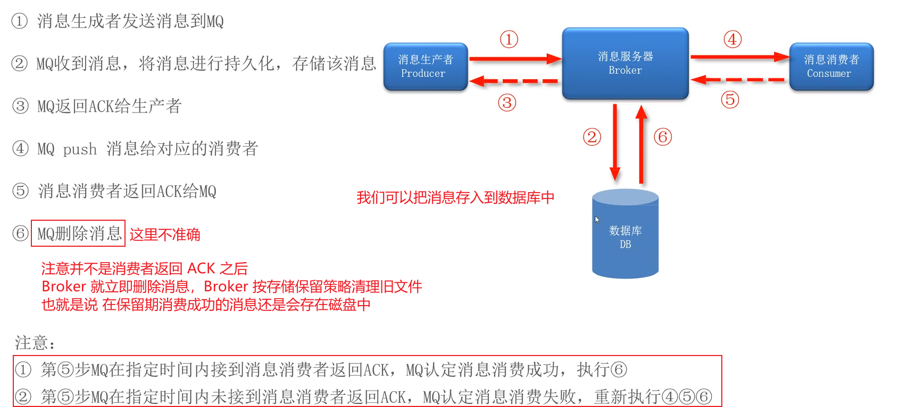

#### 为什么不在消费成功后立即删除消息？

> 因为 RocketMQ 支持多个消费者组独立消费同一个 Topic。
>
> 假设 Group A 消费完 5 条消息就直接将它们删除，那么 Group B 后面的 3 条消息就无法消费了。
>
> 当然消息一直没有被消费者消费，也可能因为超过存储保留期限而被删除。
>
> RocketMQ 不是永久存储系统。消费者长时间停止运行，就要注意消息保留时间和消费积压问题。

#### RocketMQ 的 Broker 接收到消息后，会把消息放在内存中，那么消费者消费成功后，Broker 内存中的消息什么时候被清理？

> 不会因为消费者消费成功就立即清理内存中的消息。RocketMQ 主要利用操作系统的 PageCache（页缓存）缓存消息，缓存什么时候被回收，主要由操作系统的内存管理机制决定。

#### Broker 存储在磁盘的消息什么时候会被删除呢？

假如 Broker 配置：

```properties
# 消息文件保留时间：72小时
fileReservedTime=72

# 每天凌晨4点执行定时清理检查
deleteWhen=04
```

>  假设某条消息在星期一上午 10 点写入 Broker，保留时间为 72 小时：
>
> + 星期一 10:01，消费者就已经成功消费。
> + 星期二，消息可能仍保留在磁盘。
> + 星期三，消息可能仍保留在磁盘。
> + 星期四 10:00，该消息达到 72 小时的保留时间。
>
> 但是，不代表星期四 10:00 这条消息就会立即被删除。
>
> RocketMQ 4.x 通常以 CommitLog 文件为单位清理过期数据，还要考虑清理检查时间、文件保留条件等。主要以 CommitLog 文件为单位删除，而不是每消费成功一条就删除一条。
>
> 另外，当磁盘使用率达到相应阈值时，也可能提前触发清理。

### c.把Broke 中的消息存储到本地文件

> 既然数据库也要存到本地磁盘，那我们可以直接存到本地磁盘。
>
> 采用消息刷盘机制进行数据存储。
>
> 这样性能更高，例如 RocketMQ、RabbitMQ、Kafka
>
> 缺点： 硬盘损坏的问题无法避免


## 2.高效的消息存储与读写方式：

### a. 高效写：

RocketMQ 采用的是 **CommitLog 顺序追加写** 的方式。在 RocketMQ 4.x 中，默认每个 CommitLog 文件大小为 **1 GiB（可配置）**。

RocketMQ 会创建固定大小的 CommitLog 文件，并将同一个 Broker 接收到的不同 Topic、不同 Queue 的完整消息，统一顺序追加到 CommitLog 文件末尾。

这种方式具有以下优势：

+ **减少随机磁盘 IO**：消息按照文件逻辑偏移量连续写入，减少随机寻址开销。
+ **提高写入吞吐量**：连续写入更有利于操作系统合并 IO 请求，充分利用磁盘的顺序写性能。
+ **减少文件扩容开销**：采用固定大小的文件分段，并可以提前创建后续文件，减少文件扩容和切换带来的开销。

> 需要注意的是，**顺序写指的是文件逻辑地址上的连续写入，并不意味着数据一定存储在连续的物理磁盘空间中**。实际物理存储位置由文件系统和存储设备管理。

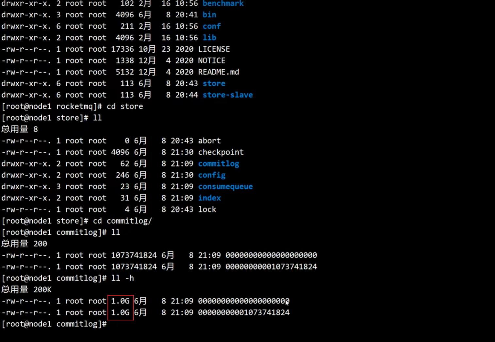

为什么是1G?

> 可以自己设置 打开conf目录下的 我们用的两主两从模式，所以进入这个目录，打开对应Linux 配置文件 比如这个虚拟机用的是 broker-a.properties

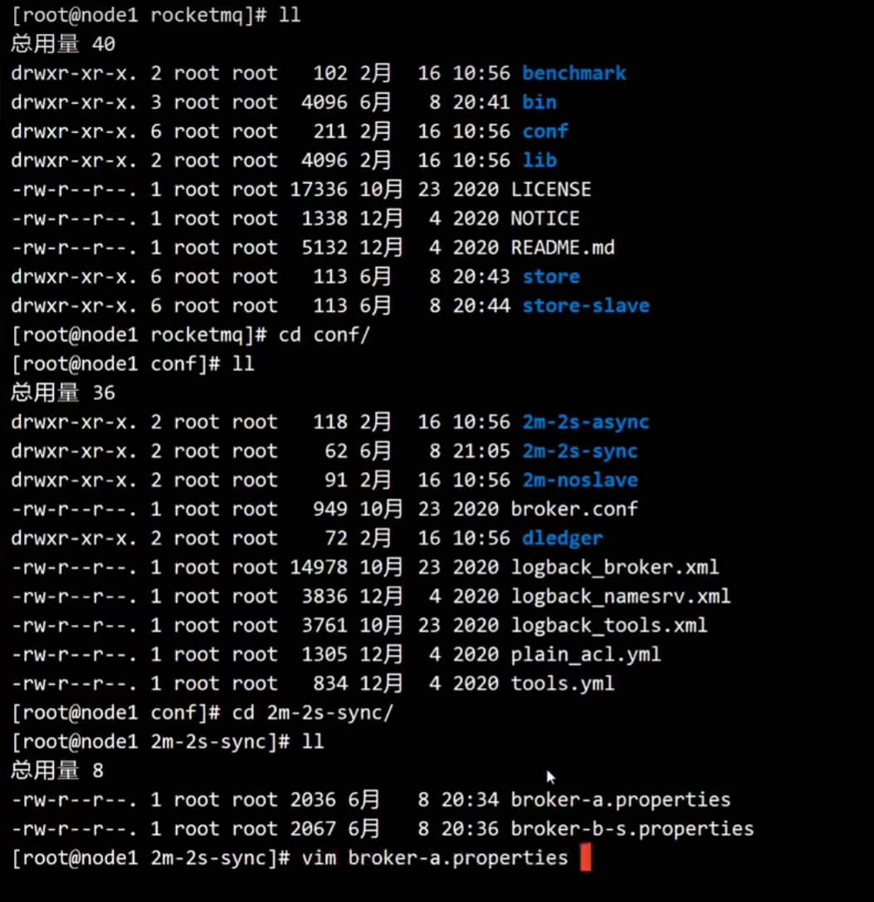

打开之后可以修改对应的commitLog大小

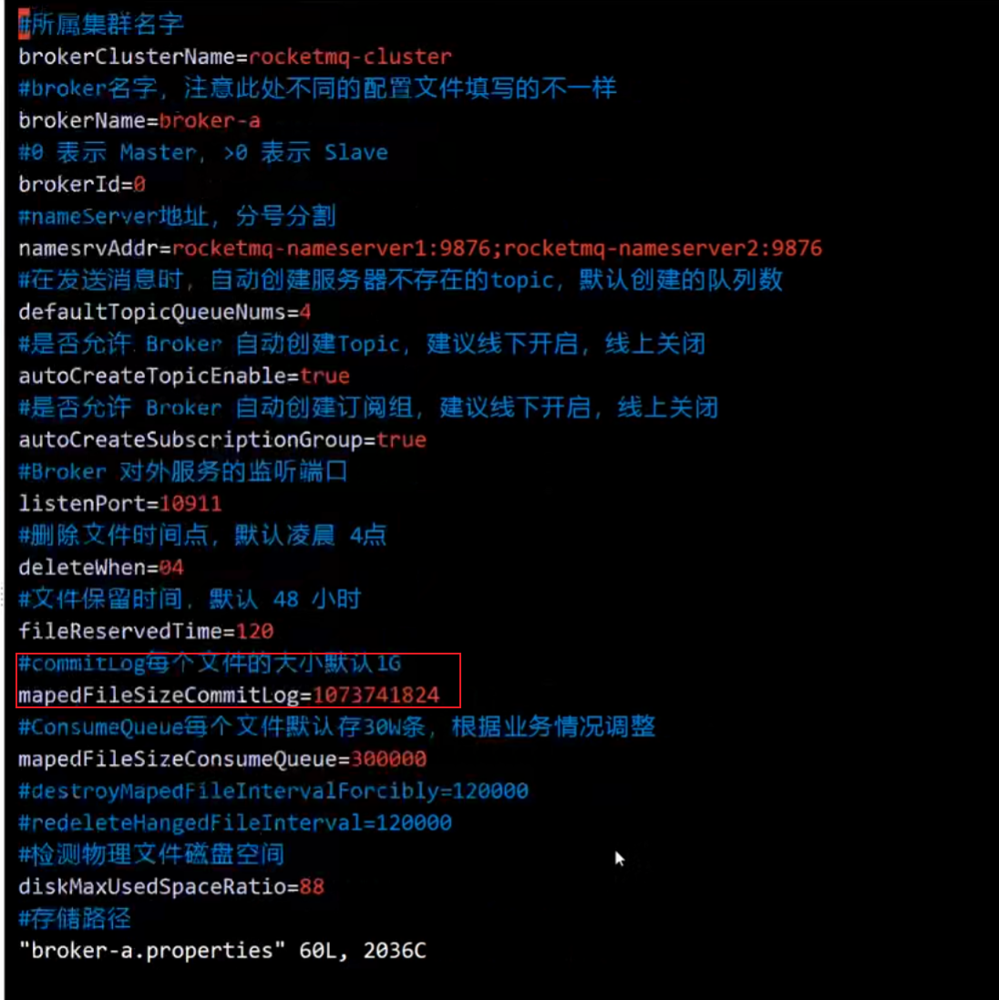

> RocketMQ 将不同 Topic、不同 Queue 的消息统一顺序追加到 CommitLog 文件中，避免了随机写带来的频繁磁盘寻址开销，提高了磁盘写入吞吐量。同时，通过 mmap 内存映射技术，将磁盘文件映射到进程的虚拟地址空间，利用操作系统的 PageCache 缓存数据。消息写入时，通常先写入 PageCache，再由操作系统和 RocketMQ 的刷盘机制将数据持久化到磁盘，减少直接等待磁盘 IO 的时间。在异步刷盘模式下，Broker 不必等待每条消息真正落盘后才返回发送结果，并且可以合并多次写入，进一步提升写入性能。


### b.高效读：

#### 1.先看一下Consumer是如何获取消息的

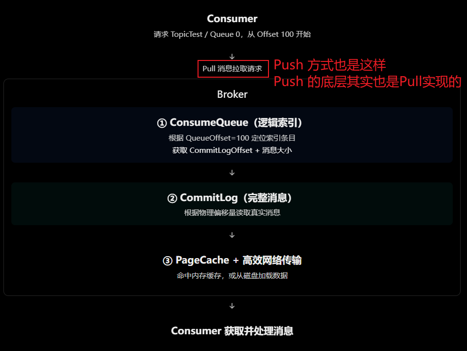

#### 2.ConsumeQueue：

如果没有 ConsumeQueue，就需要查找 CommitLog 中哪些消息属于这个队列，扫描成本高。

RocketMQ 通过 ConsumeQueue 建立索引：

| QueueOffset | CommitLogOffset | 消息大小 |
| ----------- | --------------- | -------- |
| 0           | 1000            | 200      |
| 1           | 1400            | 200      |
| 2           | 1800            | 200      |

这样消费者只需根据 `QueueOffset` 找到对应索引，然后通过 `CommitLogOffset` 读取完整消息。

RocketMQ 4.x 的 ConsumeQueue 索引条目采用固定长度 20 字节：

| 字段              | 大小    | 作用                      |
| ----------------- | ------- | ------------------------- |
| `CommitLogOffset` | 8 字节  | 消息在 CommitLog 中的位置 |
| `Size`            | 4 字节  | 消息长度                  |
| `TagsCode`        | 8 字节  | Tag 过滤相关编码          |
| 合计              | 20 字节 |                           |

因此，当队列中的 `QueueOffset=100` 时，对应索引条目在 ConsumeQueue 逻辑文件中的位置就是： 100*20=2000 字节

> 通过一个简单的乘法，就能定位索引条目的位置，再根据索引找到对应的消息位置。

#### 3.PageCache

> PageCache 是操作系统使用内存缓存文件数据的机制。

当 Broker 读取 CommitLog 中的消息时：

+ 如果消息所在的数据页已经在 PageCache 中，就可以直接从内存中的缓存访问。
+ 如果没有命中，就需要从磁盘加载对应的数据页，之后这些页也可以留在 PageCache 中。

> 这其实很类似于 Redis与MySQL等数据库的关系，核心机制都是把需要的数据放到更快的处理空间中，从而换得更快的响应速度。
>
> 当然Redis与MySQL这种关系是 借鉴的操作系统。

#### 4.mmap:减少文件访问开销

> Memory-Mapped File，内存映射文件

mmap 会将文件映射到进程的虚拟地址空间，使程序可以通过内存地址访问文件内容。

传统文件读取通常是：

```text
磁盘 → PageCache → 用户态缓冲区 → 业务处理
```

使用 mmap 后，在适用的读取路径中：

```text
磁盘 → PageCache（映射到进程虚拟地址空间）
                   ↓
               业务处理
```

这样可以减少常规 `read()` 路径中，从内核 PageCache 向用户态缓冲区复制数据的开销。

> 不过，mmap 不意味着消除了所有数据复制，也不意味着磁盘文件会完整加载到内存中。

#### 5.零拷贝：提高消息网络发送效率

> 消费者最终需要通过网络从 Broker 获取消息。

RocketMQ 4.x 在适用的消息传输路径上，可以使用 `FileRegion`、`transferTo` 等机制，利用操作系统的 `sendfile` 类能力，减少内核态和用户态之间不必要的数据复制。

如图是 传统IO与零拷贝的对比：

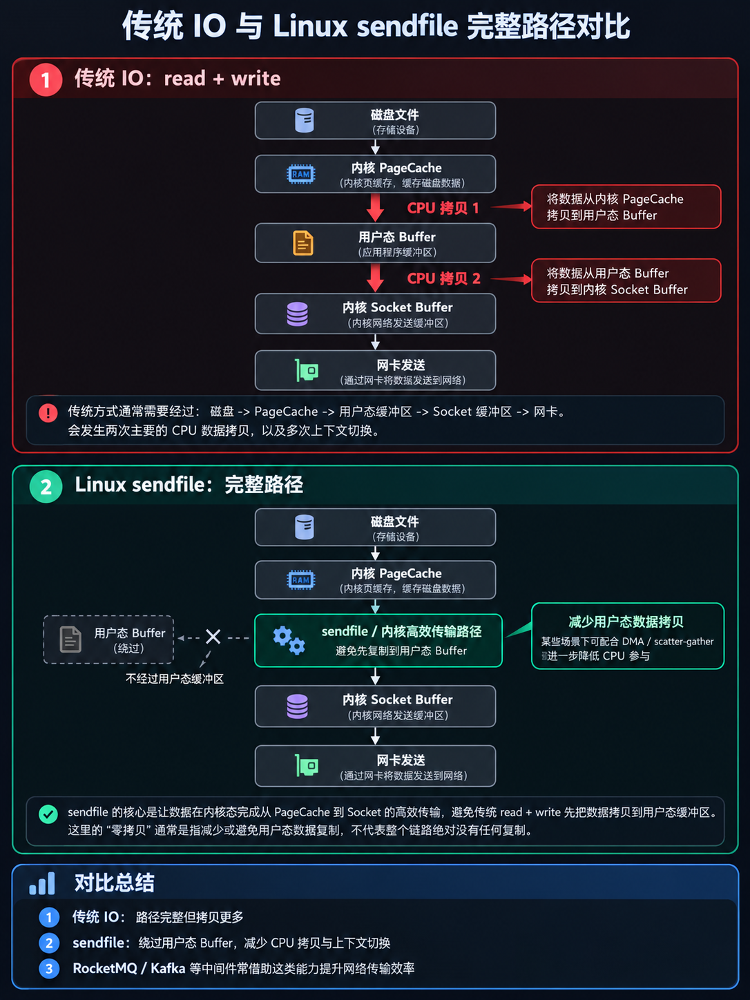

> 这个零拷贝是Linux操作系统的一种技术，也是一种思想，在Windows上也可以实现

> 在 Linux 上，RocketMQ 可以利用 Linux 的 `mmap`、`sendfile` 等机制。
>
> 在 Windows 上，也可以使用 Java NIO 和操作系统提供的相应能力。
>
> 对于生产环境，RocketMQ 通常更推荐部署在 Linux 上。

#### 6.批量拉取：减少网络交互次数

RocketMQ 的消费者通常不是每消费一条消息就单独向 Broker 发起一次网络请求，而是可以批量拉取多条消息。

#### 总结一下：

> RocketMQ 能够实现高效读取，核心原因是采用了 ConsumeQueue 索引 + mmap 内存映射 + PageCache 页缓存 + 零拷贝 + 批量拉取 等技术。
>
> 首先，RocketMQ 通过 ConsumeQueue 为每个 Topic 的 Queue 建立逻辑索引，消费者可以根据 QueueOffset 快速获取消息在 CommitLog 中的物理位置，避免扫描整个 CommitLog。其次，通过 mmap 内存映射和操作系统的 PageCache 缓存机制，热点消息可以直接从内存缓存中读取，减少磁盘 IO。同时，RocketMQ 在适用的网络传输路径中利用零拷贝技术，降低数据在内核态与用户态之间的复制开销。最后，通过批量拉取和长轮询，减少网络请求及调度开销，从而实现高吞吐、低延迟的消息读取。


## 3.消息存储结构：

如图是简单的消息存储结构：

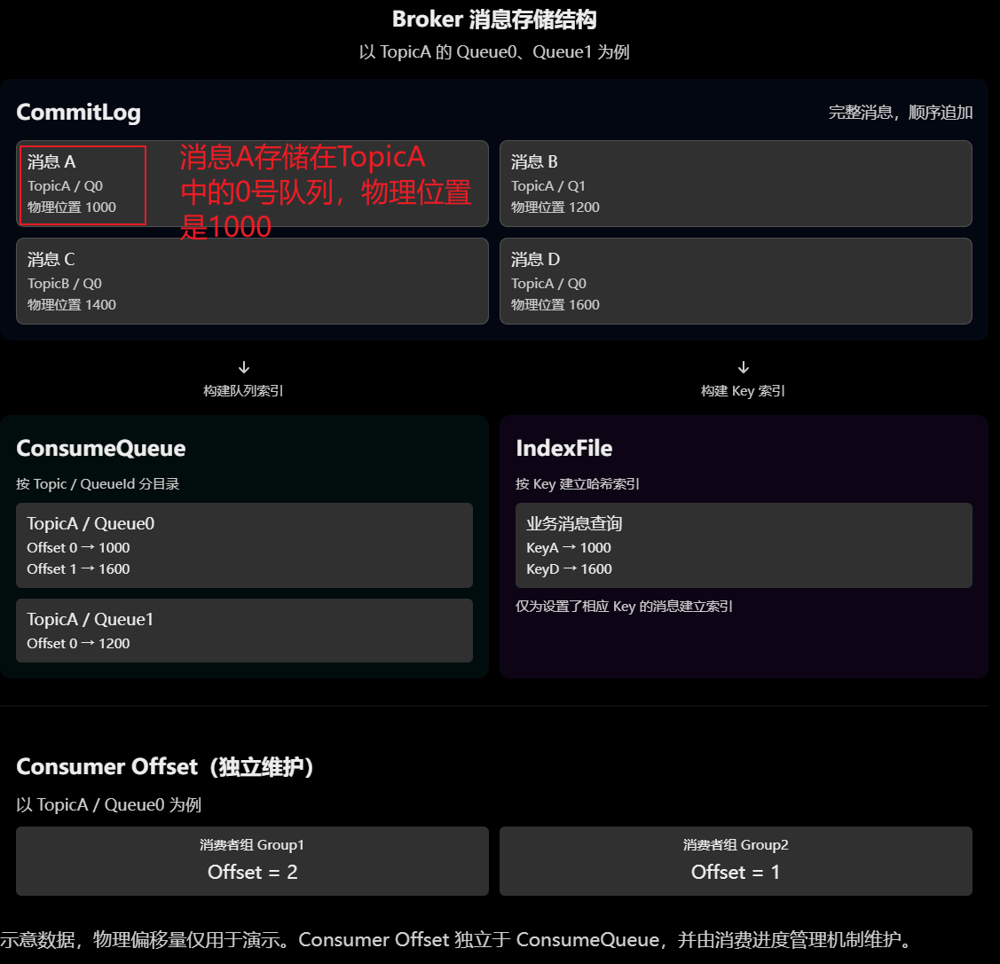

> ConsumeQueue  记录消息在 CommitLog 中的物理位置，供消费者快速定位消息
>
> Consumer Offset  记录某个消费者组在某个队列上的消费进度
>
> IndexFile 当想查找某一条特定的历史消息时，可以通过消息的 Key 快速定位它，而不需要遍历整个 CommitLog。
>
> 
>
> 消息从生产者发送到 RocketMQ 中，由 CommitLog 存储完整信息， 
>
> > CommitLog 存储完整消息，ConsumeQueue 和 IndexFile 存储索引，并不是分别保存三份完整的消息。

这是课程里面的图：

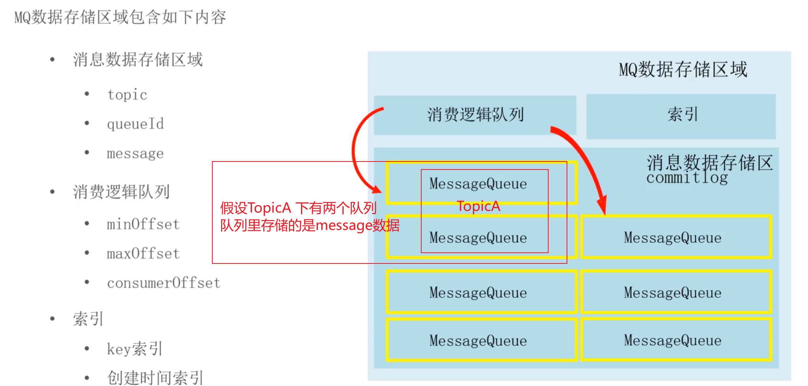

###  RocketMQ 的三个存储结构：

| 存储结构       | 作用                    | 解决什么问题                        |
| -------------- | ----------------------- | ----------------------------------- |
| `CommitLog`    | 存储完整消息            | 消息保存在哪里？                    |
| `ConsumeQueue` | 维护队列的逻辑索引      | 消费者下一条应该读取哪条消息？      |
| `IndexFile`    | 维护消息 Key 的哈希索引 | 如何根据业务 Key 快速找到一条消息？ |

ConsumeQueue 适合按队列偏移量读取，IndexFile 适合按业务 Key 查询。

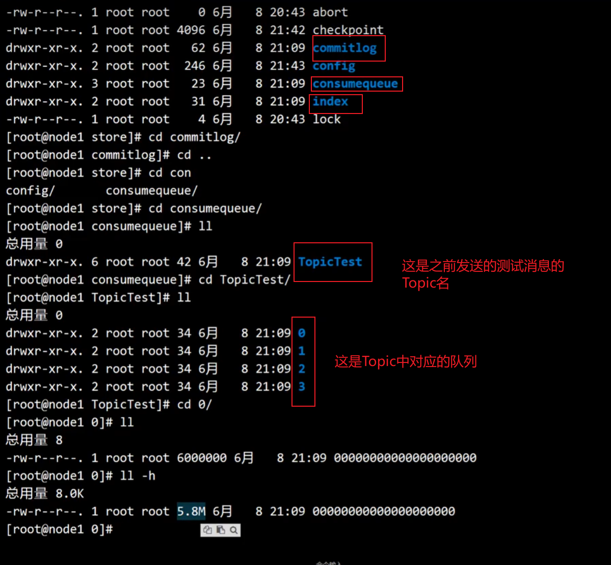

>  RocketMQ 4.x 中，ConsumeQueue 每个索引条目占 20 字节，默认每个索引文件可以容纳 30 万条索引：30 0000*20=600 0000字节  600 0000/1024<sup>2</sup> ≈5.72MB
>
> 所以显示的5.8M
>
> **5.8M 是索引文件的预设逻辑大小，不代表文件中已经写满了 30 万条消息索引。**

而真正的消费进度应该保存在类似这种目录下：

```cmd
store/
├── commitlog/
│   └── 完整消息数据
│
├── consumequeue/
│   └── TopicTest/
│       ├── 0/
│       ├── 1/
│       ├── 2/
│       └── 3/
│
├── index/
│   └── Key 索引文件
│
└── config/
    └── consumerOffset.json
        └── 消费者组的消费进度
```


#### a. CommitLog:

##### 1. 为什么需要 CommitLog？

假设有两个 Topic，每个 Topic 有不同的 Queue。

生产者发送以下消息：

```text
消息A → Topic1 / Queue0
消息B → Topic2 / Queue1
消息C → Topic1 / Queue1
消息D → Topic1 / Queue0
```

如果直接把完整消息分别写入不同的队列文件，就可能造成频繁的文件切换与分散写入。

RocketMQ 采用了更高效的设计：

同一个 Broker 接收的不同 Topic、Queue 的完整消息，统一顺序追加到 CommitLog。

特点：

+ 顺序追加写：提高磁盘写入吞吐量。

  > 消息按照文件逻辑偏移量连续写入，减少随机寻址开销。

+ 存储完整消息：包括消息体、Topic、QueueId、时间戳和各种属性。

+ 文件分段管理：RocketMQ 4.x 默认每个 CommitLog 文件大小为 1 GiB（可配置）。

  > 通过固定大小的文件分段和预创建机制，减少文件频繁创建、扩容和切换带来的开销。

+ 全局物理偏移量：通过 `commitLogOffset` 定位消息的存储位置。

##### 2. CommitLog 中每条消息存储什么？

| 字段             | 作用                        |
| ---------------- | --------------------------- |
| `TOTALSIZE`      | 整条消息的存储大小          |
| `MAGICCODE`      | 用于识别消息记录格式        |
| `BODYCRC`        | 消息体 CRC 校验             |
| `QUEUEID`        | 所属队列编号                |
| `QUEUEOFFSET`    | 在队列中的逻辑偏移量        |
| `PHYSICALOFFSET` | 在 CommitLog 中的物理偏移量 |
| `BORNTIMESTAMP`  | 生产者产生消息的时间        |
| `STORETIMESTAMP` | Broker 存储消息的时间       |
| `BODY`           | 真正的消息内容              |
| `TOPIC`          | 消息所属主题                |
| `PROPERTIES`     | Tag、Key 等扩展属性         |

> 这只是主要字段。RocketMQ 4.x 的完整消息记录还包含标志位、主机地址、重试次数、事务相关偏移量等。

####  b. ConsumeQueue：消息的逻辑队列索引

##### 1. 为什么需要 ConsumeQueue？

因为 CommitLog 中的消息是混合存储的。

例如现在有四个消息：

```text
CommitLog：
位置1000 → TopicA / Queue0 / 消息A
位置1200 → TopicB / Queue0 / 消息B
位置1400 → TopicA / Queue1 / 消息C
位置1600 → TopicA / Queue0 / 消息D
```

假设消费者只想读取： `TopicA / Queue0`, 需要找到消息 A 和消息 D。

如果每次都扫描整个 CommitLog，效率就很低。

因此 RocketMQ 为每个 Topic 的每个 Queue 建立独立的 ConsumeQueue 索引。

#####  2.ConsumeQueue 的数据结构

RocketMQ 4.x 的 ConsumeQueue 每条索引固定占用 20 字节。

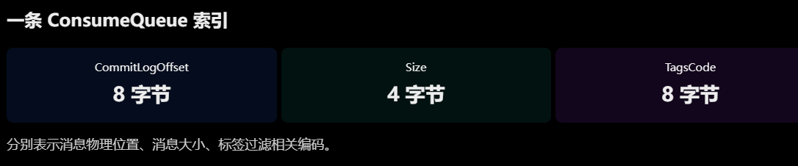

例如 TopicA 的 Queue0：

| QueueOffset | CommitLogOffset | Size | TagsCode |
| ----------- | --------------- | ---- | -------- |
| 0           | 1000            | 200  | HashA    |
| 1           | 1600            | 200  | HashA    |

消费者想读取 QueueOffset=1 的消息，就可以直接根据固定长度计算索引位置：`1*20=20`

查到索引后，就知道要从 CommitLog 的位置 1600 读取 200 字节。

> 这就是 ConsumeQueue 高效的原因：通过逻辑偏移量快速定位索引，再利用物理偏移量找到完整消息，不需要扫描整个 CommitLog。
>
> 当然真正的消息内容仍然在 CommitLog 中。

### c. IndexFile：按 Key 查询消息

IndexFile 不是消费者正常顺序消费时必须走的索引，它主要用于消息查询。

例如生产者发送：

```java
Message msg = new Message(
    "OrderTopic",
    "TagA",
    "订单支付成功".getBytes(StandardCharsets.UTF_8)
);

msg.setKeys("ORDER_10001");
```

RocketMQ 可以为 `ORDER_10001` 建立查询索引。

概念上可以理解为：

```
IndexFile

ORDER_10001
     ↓
CommitLogOffset #某个消费者组消费到了哪个位置
     ↓
CommitLog 中的完整消息
```

实际 IndexFile 使用哈希槽和索引条目组织数据，查询时还需要处理哈希冲突等情况。

| 对比           | ConsumeQueue                | IndexFile              |
| -------------- | --------------------------- | ---------------------- |
| 主要用途       | 正常消息消费                | 根据 Key 查询消息      |
| 查找依据       | Topic、QueueId、QueueOffset | 消息 Key 等索引信息    |
| 存储内容       | 物理偏移量、长度、TagsCode  | Key 哈希、物理偏移量等 |
| 是否存完整消息 | 否                          | 否                     |

> 实际企业开发中，IndexFile 通常不是业务查询的主要手段。大部分业务数据查询会使用 MySQL，而 IndexFile 更多是用于 RocketMQ 消息排查、追踪和运维诊断。

## 4.刷盘机制：

同步刷盘：

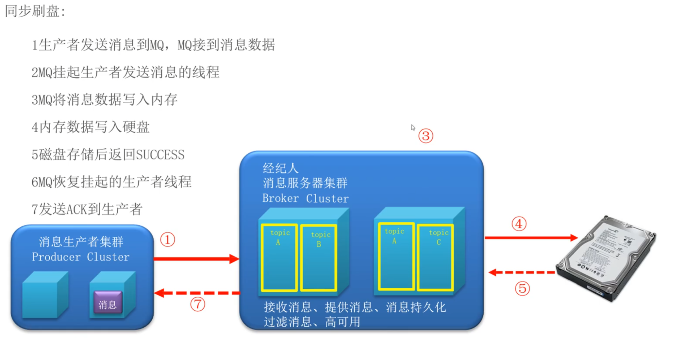

异步刷盘：

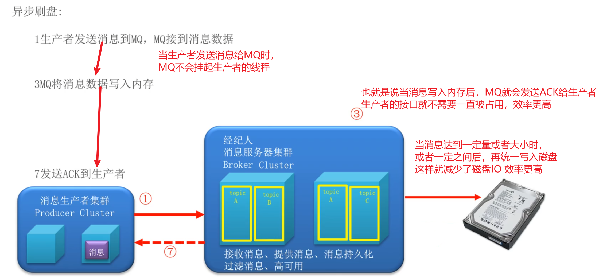

如何选择：

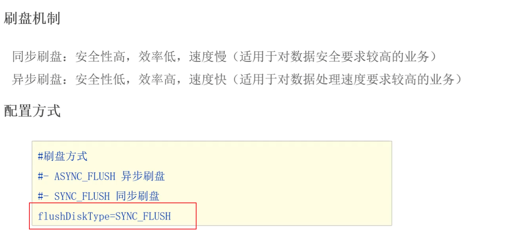

如何配置：

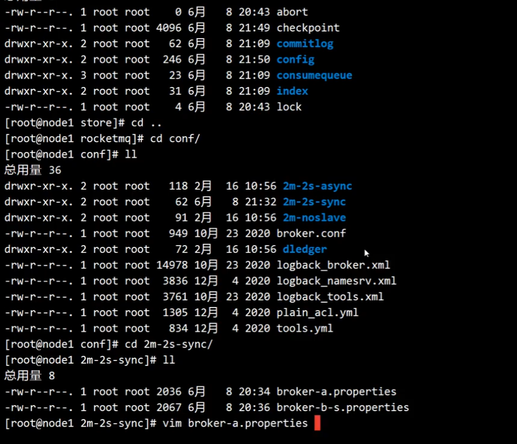

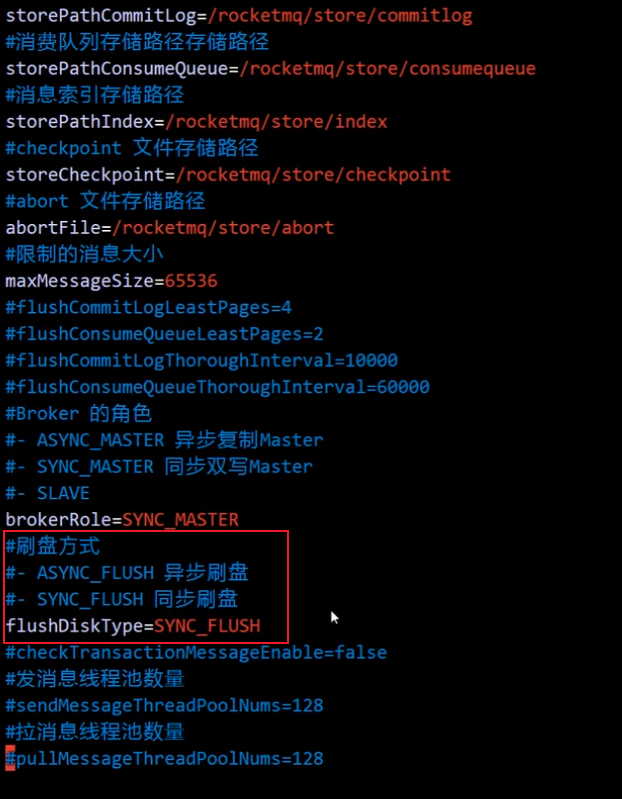


## 5. 高可用性：

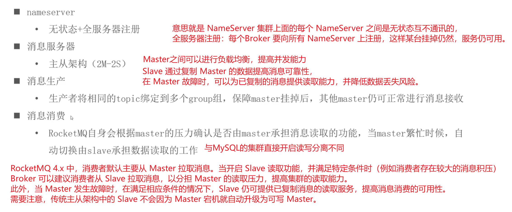

> **无状态是指：服务节点不依赖自身保存的持久化状态来提供服务，请求处理不依赖之前的请求历史。**
>
> 假设有三个 NameServer：
>
> 如果 NameServer 2 突然宕机：
>
> + NameServer 1 和 3 不受它的直接影响，可以继续提供路由查询。
> + Broker 仍然能够向其他正常的 NameServer 注册。
> + 客户端能够连接其他正常的 NameServer，就可以继续获取路由。
>
> 如果 NameServer 2 重启，它可以通过 Broker 后续重新注册，恢复路由信息，而不需要从其他 NameServer 复制持久化数据库。
>
> 
>
> **RocketMQ 的 NameServer 采用无状态设计，各节点相互独立，不需要彼此同步数据。Broker 会定期向所有配置的 NameServer 注册路由信息，NameServer 主要在内存中维护这些信息，不依赖路由数据的本地持久化。因此，单个 NameServer 宕机后，其他节点仍能提供服务；故障节点重启后，可以通过 Broker 重新注册恢复路由信息。**

### 主从复制的两种方式：

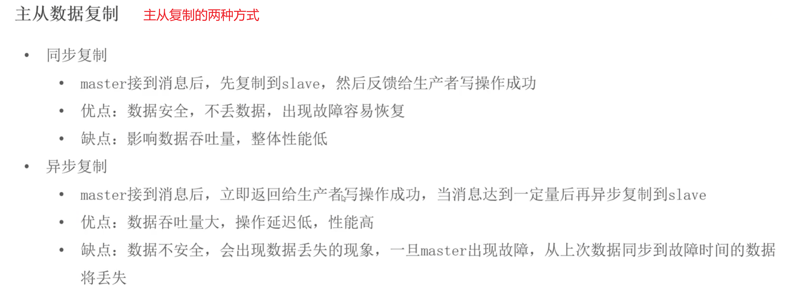

配置主从复制的方式：

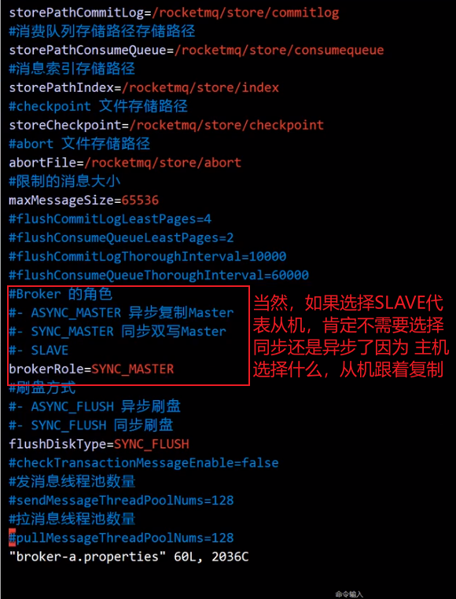


## 6. 负载均衡：

### Producer 负载均衡： （写方面）

#### 一、生产者负载均衡策略

| 策略                | 核心原理                                      | 适用场景             |
| ------------------- | --------------------------------------------- | -------------------- |
| 轮询（Round Robin） | 按顺序依次选择不同的 MessageQueue             | 普通消息，默认策略   |
| 随机（Random）      | 随机选择一个可用 MessageQueue                 | 普通消息，自定义策略 |
| Hash 分配           | 根据订单 ID 等业务 Key 的 Hash 值选择固定队列 | 顺序消息、业务分区   |
| 自定义策略          | 根据业务规则选择指定队列                      | 机房优先、流量隔离等 |
| 故障规避            | 发送失败或延迟较高时，尽量避开异常 Broker     | 提高发送可用性       |

注意：这些并不是五种同级的内置默认算法。RocketMQ 4.x 默认采用轮询式选队列；随机、Hash 和其他特殊规则可通过 `MessageQueueSelector` 实现；故障规避则属于发送过程中的容错机制。

#### 二、轮询策略（默认）

假设 `TopicTest` 有 4 个可用队列，队列按 Q0 → Q1 → Q2 → Q3  →Q0 这样循环选择。

> 但这不代表每条消息大小相同，或每个 Broker 的实际负载一定完全相等。

####  三、Hash 分配策略（用于顺序消息）

例如一个订单会产生三条消息：

```
订单 1001：
    创建订单
    支付订单
    完成订单
```

如果使用默认轮询，可能出现：

```
创建订单 → Queue0
支付订单 → Queue1
完成订单 → Queue2
```

不同队列可以并行消费，因此可能出现消费顺序不一致的问题。

这时候可以根据订单 ID 选择队列：

示例：

```java
producer.send(msg, new MessageQueueSelector() {
    @Override
    public MessageQueue select(
            List<MessageQueue> mqs,
            Message msg,
            Object arg) {

        Long orderId = (Long) arg;

        int index = Math.floorMod(//保证索引非负
            orderId, mqs.size() //这里就是取模运算 只不过在被除数是负数是会有区别
        );
		//System.out.println(-10 % 3);              // -1
		//System.out.println(Math.floorMod(-10, 3)); // 2
        return mqs.get(index);
    }
}, orderId);
```

同一个订单 ID 会被映射到同一个队列（前提是可用队列列表及其顺序保持稳定）。

这样不同订单仍然可以分散到不同队列，提高并行处理能力。

> 不过，同一订单进入同一队列还不够：需要生产者按顺序发送、消费者使用顺序消费机制，才能正确保证消息顺序。

#### 四、故障规避策略

假设 Topic 有两个 Broker：

```text
Broker A : Queue0、Queue1
Broker B : Queue0、Queue1
```

现在 Broker A 发生故障。

在发送重试时，RocketMQ 可以尽量选择其他 Broker 的队列。

RocketMQ 4.x 还提供发送延迟故障规避配置：

```java
producer.setSendLatencyFaultEnable(true);
```

开启后，客户端可以根据 Broker 最近的发送延迟和失败情况，在一定时间内规避异常 Broker。

> 它属于负载均衡基础上的容错优化

> RocketMQ 生产者的负载均衡主要由客户端完成。Producer 首先根据 Topic 获取可用 MessageQueue 的路由信息，然后选择目标队列发送消息。默认情况下，RocketMQ 采用轮询式策略，让消息相对均匀地分配到不同队列，从而分散 Broker 的写入压力。此外，开发者可以通过 `MessageQueueSelector` 实现随机选择、Hash 分配或其他业务路由策略。其中，Hash 分配常用于顺序消息，确保相同业务 Key 的消息进入同一队列。RocketMQ 还提供发送失败重试和延迟故障规避机制，尽量避免向异常 Broker 持续发送消息，提高发送可靠性。

### Consumer 负载均衡： （读方面）

#### 一、集群消费（Clustering）（负载均衡）—— 默认模式

**同一个 ConsumerGroup 中**，一条消息通常只由其中一个消费者实例负责消费。

> 在 RocketMQ 4.x 中，同一个 ConsumerGroup 可以订阅一个或多个 Topic。在集群消费模式下，RocketMQ 会以 Topic 的 MessageQueue 为单位，将队列分配给组内不同的消费者实例。
>
> 对于任意一个被订阅的 Topic，一条消息在正常情况下只会由该 ConsumerGroup 中的一个消费者实例负责消费，从而实现组内负载均衡。
>
> 不同 ConsumerGroup 之间相互独立，可以分别订阅和消费同一个 Topic 的消息。

不过，RocketMQ 采用至少一次投递语义，在消费者宕机、消费进度未及时持久化或 Rebalance 等情况下，同一条消息仍可能被组内不同的消费者重复处理。

> + 在同一个 ConsumerGroup 内部，采用集群消费模式时，多个消费者实例共同分摊消息，一条消息通常只由组内一个消费者实例处理。
> + 不同 ConsumerGroup 之间相互独立，即使都采用集群消费模式，也可以各自消费同一个 Topic 的全部订阅消息。
> + 广播消费模式则是指，同一个 ConsumerGroup 内的每个消费者实例都会消费全部订阅消息。

假设 `TopicTest` 有 4 个队列，ConsumerGroup A 中有两个消费者。

Consumer A 和Consumer B 各负责两个队列，这就是负载均衡。

例如 Queue0 有 100 条消息，由 Consumer A 负责；Queue2 有 200 条消息，由 Consumer B 负责。这样两个消费者就可以同时处理消息，提升整体消费吞吐量。

> 并不是每个消费者都读取所有队列，而是分工消费。

RocketMQ 4.8.0 在集群消费模式下，提供了多种 MessageQueue 分配策略。

| 策略             | 类名                                    | 工作原理                                         |
| ---------------- | --------------------------------------- | ------------------------------------------------ |
| 平均分配（默认） | `AllocateMessageQueueAveragely`         | 把队列尽可能平均地按连续区间分配                 |
| 环形平均分配     | `AllocateMessageQueueAveragelyByCircle` | 按轮次交替给不同消费者分配队列                   |
| 一致性 Hash      | `AllocateMessageQueueConsistentHash`    | 通过一致性哈希环分配队列，尽量减少扩缩容时的迁移 |
| 机房分配         | `AllocateMessageQueueByMachineRoom`     | 根据机房信息分配消息队列                         |
| 手动指定         | `AllocateMessageQueueByConfig`          | 按照开发者指定的队列列表消费                     |

另外还有机房就近分配等扩展策略。

**平均分配和环形平均分配有什么区别？**

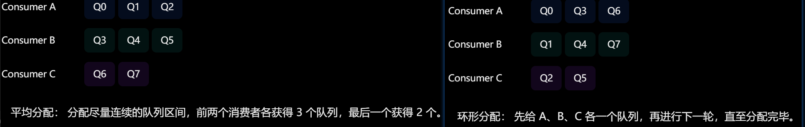

实际开发中，通常直接使用默认的 `AllocateMessageQueueAveragely` 即可。

#### 二、广播消费（Broadcasting）

**同一个 ConsumerGroup 中**，每个消费者实例都会消费 Topic 中的全部消息。

还是上面的例子，此时两个消费者都读取全部队列，而不是把队列分配后各消费一部分。

| 对比                 | 集群消费           | 广播消费                   |
| -------------------- | ------------------ | -------------------------- |
| 消费范围             | 组内消费者分摊消息 | 每个消费者都消费全部消息   |
| 消费进度             | 通常存储在 Broker  | 通常存储在消费者本地       |
| 消费失败重试         | 支持服务端重试机制 | 不支持相同的服务端重试机制 |
| 队列分配             | 组内分配不同队列   | 每个实例读取全部队列       |
| 主要用途             | 订单处理、异步任务 | 配置同步、通知所有实例     |
| 是否为默认模式       | 是                 | 否                         |
| 是否通过队列分摊负载 | 是                 | 否                         |

Java 设置方式：

```java
// 集群消费（默认）
consumer.setMessageModel(MessageModel.CLUSTERING);

// 广播消费
consumer.setMessageModel(MessageModel.BROADCASTING);
```

注意，广播模式下每个消费者都会处理消息，并且 RocketMQ 4.x 的广播消费不具备与集群消费相同的服务端失败重试机制。


#### 三、另外介绍一个机制：Rebalance：消费者重新分配队列

Rebalance（重平衡）是 Consumer 负载均衡的重要机制。

例如原来只有两个消费者：

| 消费者     | 负责的队列 |
| ---------- | ---------- |
| Consumer A | Q0、Q1     |
| Consumer B | Q2、Q3     |

现在 Consumer C 加入消费组，那么原来的分配就需要调整：

| 消费者     | 重新分配后 |
| ---------- | ---------- |
| Consumer A | Q0、Q1     |
| Consumer B | Q2         |
| Consumer C | Q3         |

这个重新计算和分配队列的过程，就叫 Rebalance。

在 RocketMQ 4.8.0 中，其大致工作流程是：

1. 消费者获取当前 Topic 的 MessageQueue 列表。
2. 从 Broker 获取当前 ConsumerGroup 中的消费者实例列表。
3. 对队列列表和消费者列表排序，根据分配算法计算本实例负责的队列。
4. 更新本地队列分配状态，释放不再负责的队列，开始拉取新分配队列的消息。
5. 根据 Consumer Offset 恢复对应队列的消费进度。

Rebalance 通常在消费者加入、退出、故障以及 Topic 队列变化等情况下触发；RocketMQ 也会定期检查分配状态。

##### Rebalance 有什么问题？

可能导致消息重复消费。

例如：

1. Consumer A 已经处理完 Q0 中 Offset=100 的消息。
2. 但最新消费进度还没有持久化到 Broker。
3. Consumer A 宕机，触发 Rebalance。
4. Consumer B 接管 Q0，从 Broker 保存的旧进度继续消费。
5. Offset=100 的消息可能再次被处理。

所以消费者负载均衡虽然能够提高消费吞吐量，但业务层面仍然需要保证幂等性。

> **另外，消费者数量并不是越多越好。当消费者实例数量大于 MessageQueue 数量时，部分消费者无法分配到队列，处于空闲状态。因此，单纯增加消费者实例不一定能提高消费吞吐量。需要根据队列数量、消息处理耗时和消费线程数等因素综合调整。**


## 7. 消息重试：

生产者发送消息重试和消费者消费消息重试对比：

| 对比         | 生产者发送重试                  | 消费者消费重试                     |
| ------------ | ------------------------------- | ---------------------------------- |
| 发生阶段     | Producer → Broker               | Broker → Consumer 之后的处理阶段   |
| 触发原因     | 发送超时、网络异常、发送失败等  | 消费者业务处理失败、返回失败状态等 |
| 主要目的     | 尽可能确保消息成功发送到 Broker | 尽可能确保消息被成功处理           |
| 默认重试次数 | 同步发送通常失败重试 2 次       | 并发消费默认 16 次                 |
| 核心风险     | 消息重复发送                    | 消息重复消费                       |

#### 一、生产者发送重试：

##### 1. 同步发送重试

```java
DefaultMQProducer producer =
        new DefaultMQProducer("producer-group");

// 发送失败后的重试次数
producer.setRetryTimesWhenSendFailed(2);
```

这里的 `2` 表示首次发送失败后，最多再重试 2 次。

也就是说：

```
第 1 次：正常发送 → 失败
                 ↓
第 2 次：第一次重试 → 失败
                 ↓
第 3 次：第二次重试 → 成功
```

总共最多尝试 3 次，而不是 2 次。

注意，重试仍受本次发送的超时预算等因素约束，不保证一定执行满 3 次。

##### 2. 异步发送重试

```java
producer.setRetryTimesWhenSendAsyncFailed(2);
```

同样，RocketMQ 4.8.0 默认配置为失败后最多重试 2 次。

对于单向发送 `sendOneway()`，由于生产者不等待 Broker 返回发送结果，不能依靠上述确认型重试机制保证投递成功。

##### 3. 发送重试会不会导致重复消息？

会，这是生产者重试最需要注意的问题。

假设：

```text
Producer                       Broker
   |                              |
   |------ 发送消息 A ----------->|
   |                              | 成功存储 A
   |<------ 响应丢失 ----X        |
   |                              |
   | 生产者认为发送失败             |
   |                              |
   |------ 重试发送消息 A ------->|
   |                              | 再次存储 A
```

最终 Broker 可能存在两条代表同一业务操作的消息。

> 发送重试提高消息投递成功率，但无法天然保证消息只发送一次。

#### 二、消费者消费重试：

在 RocketMQ 4.8.0 中，消费者消费失败后的默认重试机制主要分为两种：

| 对比             | 顺序消费                         | 并发消费                      |
| ---------------- | -------------------------------- | ----------------------------- |
| 监听器           | `MessageListenerOrderly`         | `MessageListenerConcurrently` |
| 默认重试间隔     | 约 1 秒                          | 阶梯式延迟，首次 10 秒        |
| 默认最大重试次数 | 相当于无限重试                   | 16 次                         |
| 处理方式         | 暂停当前队列，再尝试消费         | 通过重试 Topic 延迟重新投递   |
| 对后续消息影响   | 可能阻塞当前队列                 | 通常不会阻塞原队列            |
| 达到有限重试上限 | 可按相应失败处理机制进入死信流程 | 进入死信队列                  |

顺序消息重试：

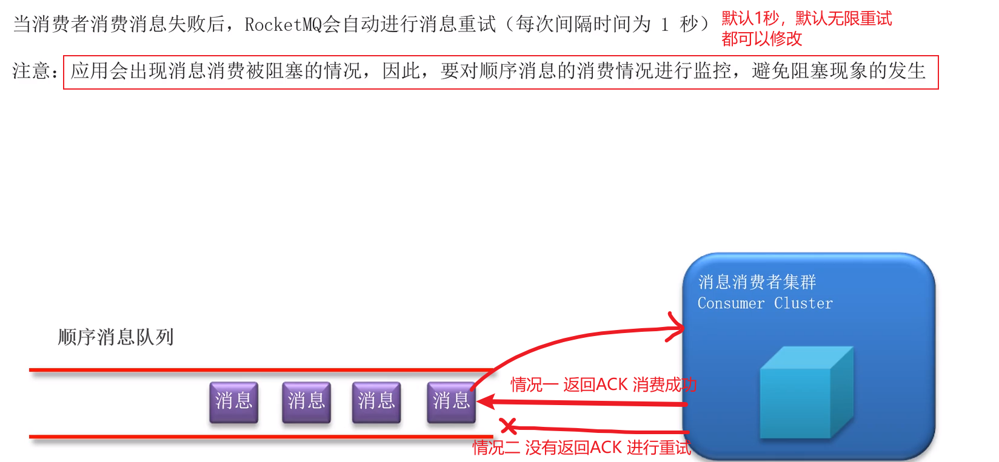

并发消息重试：

> 这里所说的**无序消息**，更准确地说是**并发消费（无序消费）（也可以说是异步）**。
>
> 在并发消费模式下，消费者通过线程池并发处理多条消息，**不需要等待前一条消息处理完成，就可以处理后续消息**。由于不同线程的处理速度可能不同，因此后发送的消息可能先处理完成，无法保证消息的消费顺序。
>
> + **并发消费**：多个消费线程并发处理消息，提高消费效率。
> + **无序消费**：不保证消息按照发送顺序完成处理。
>
> > 两者的区别是：并发消费强调**消费方式**，无序消费强调**消息处理的顺序性**。在 RocketMQ 4.x 中，`MessageListenerConcurrently` 采用并发消费方式，因此不保证消费顺序。

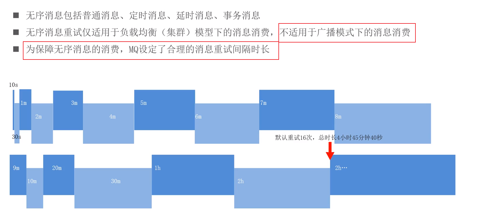

> RocketMQ 4.x 的自动消费失败重试主要适用于集群消费模式，不适用于广播消费模式。
>
> 因为集群模式下，只需要消费组中的某一个消费者实例成功处理消息，因此失败消息可以通过 `%RETRY%ConsumerGroup` 重新投递给组内消费者。
>
> 而广播模式要求每个消费者实例都独立消费全部消息。如果某个实例失败，就需要针对该实例单独重试。直接复用按消费组设计的重试机制，无法保证失败消息重新投递给正确的实例，还可能造成其他实例重复消费。
>
> 因此，RocketMQ 4.x 的广播模式不提供相同的服务端自动重试机制。如果广播消费者需要可靠的失败恢复，应由业务系统自行实现重试、失败记录和补偿机制。

## 8.死信队列：

当消息消费重试到达了指定次数 ( 默认16次 ) 后，MQ 会把无法被正常消费的消息称为死信消息 （Dead-Letter Message） 死信消息不会直接被抛弃，而是保存到一个全新的队列中，这个队列就称为死信队列 (Dead-Letter Queue)

> 死信队列的作用是将长期失败的消息隔离出来，避免它们无休止地占用正常消费资源，同时保留后续排查和补偿处理的机会。

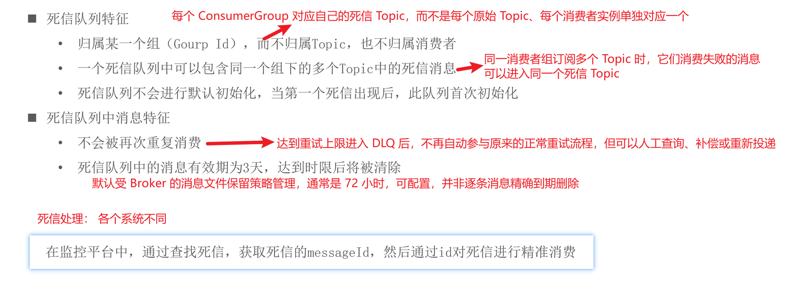

###  一、为什么死信队列是按 ConsumerGroup 划分的？

假设一个 Topic 被两个消费者组订阅：

```
OrderTopic
    │
    ├── inventory-group（库存服务）
    │
    └── points-group（积分服务）
```

对于同一条订单消息：

+ 库存消费者可能处理失败 16 次。
+ 积分消费者可能第一次就处理成功。

这时消息只需要进入库存组的死信队列，不应该影响积分组。

### 二、死信消息的处理：

通常处理方式：

1. 查询死信

   通过 RocketMQ Dashboard 或管理工具找到死信消息和 MessageId

2. 排查失败原因

   检查消息内容、业务日志、数据库状态，确认为什么反复失败

3. 修复问题

   例如修复代码异常、恢复数据库服务或修正业务数据

4. 重新处理

   通过管理工具或补偿程序重新投递、重新执行对应业务

5. 校验处理结果

   确认业务成功，并通过幂等机制防止重复执行

> `messageId` 主要用于定位消息，获取 MessageId 本身不等于消息已经被重新消费。是否支持一键重试，取决于所使用的 Dashboard 或管理工具。

##  9. 消息重复消费：

#### 一、消息重复消费的原因：

> **本质是因为：RocketMQ 为了保证消息尽可能不丢失，采用至少一次（At Least Once）投递语义，**因此同一条业务消息可能被消费者处理多次。

##### 1.生产者发送了重复的消息：

> Broker 可能已经存储消息，但 Producer 未收到成功响应，又发送了一次

1. 网络波动
2. 生产者宕机
3. 发送超时 （消息太大、超时时间设置过短、负载过高等）

##### 2.消费者处理成功，但消费进度没有成功保存

> 业务已经处理成功，但最新 Consumer Offset 没有成功持久化

1. 网络异常
2. 消费者宕机
3. Broker 故障

##### 3.Rebalance 动态负载均衡可能导致重复消费

假设 TopicTest 有两个 Queue：

| 消费者     | 原来负责的队列 |
| ---------- | -------------- |
| Consumer A | Queue0         |
| Consumer B | Queue1         |

现在 Consumer A 因为网络抖动与 Broker 断开联系。

RocketMQ 可能认为 Consumer A 已离线，于是触发 Rebalance，将 Queue0 分配给 Consumer B。

但可能发生：

1. Consumer A 已经处理了 Queue0 的 Offset=100。
2. Consumer A 的最新消费进度还没有持久化。
3. Consumer B 接管 Queue0。
4. Consumer B 根据旧进度重新消费 Offset=100。
5. 同一条消息再次被处理。

还有一种情况是，在队列所有权切换期间，旧消费者尚有未结束的处理任务，新消费者也开始处理，从而出现重复业务执行。

> 不是每次 Rebalance 都会造成重复消费，而是 Rebalance 增加了消费重复发生的可能性。

##### 总结一下：

> RocketMQ 出现重复消费，主要有三个原因：
>
> ① **生产者重复发送**： Broker 已经成功存储消息，但由于网络异常导致 Producer 没有收到发送成功响应，Producer 重试后可能产生重复业务消息。
>
> ② **消费进度未成功持久化**： Consumer 已经执行完业务，但最新 Consumer Offset 尚未成功保存，此时发生宕机或网络异常，恢复后可能重新消费之前处理过的消息。
>
> ③ **Rebalance** 动态负载均衡： 消费者扩缩容、网络抖动或节点故障时，RocketMQ 会重新分配队列。如果新消费者从旧消费进度开始处理，或者队列切换期间存在未完成的消费任务，就可能发生重复消费。
>
> 解决方案： RocketMQ 采用至少一次投递语义，因此消费者需要通过业务唯一 ID、数据库唯一约束和事务等方式实现幂等性，避免重复业务执行。

### 二、如何解决消息重复消费？消息幂等：

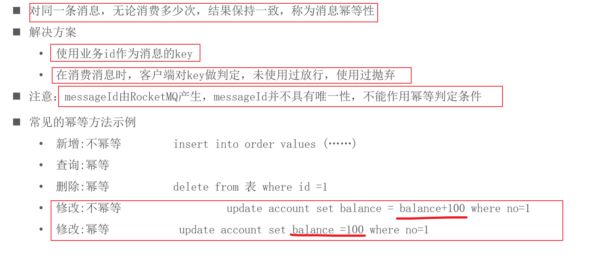

#### 实际企业中，常见的幂等方案有哪些？

| 方案                  | 核心原理                                               | 推荐场景                           |
| --------------------- | ------------------------------------------------------ | ---------------------------------- |
| 数据库唯一索引 + 事务 | 利用业务唯一 ID 去重，并保证去重记录和业务操作一起提交 | 订单、库存、支付等重要业务         |
| 数据库状态机          | 使用条件更新，避免状态重复变更                         | 订单状态流转                       |
| Redis SETNX           | 原子地抢占业务处理标识                                 | 高并发去重，通常需要额外可靠性设计 |
| 业务天然幂等          | 重复执行也不改变最终结果                               | 设置订单状态、覆盖更新等           |
| 幂等消费记录表        | 记录哪些消息对应的业务事件已经处理                     | 多种消息共用统一去重机制           |

